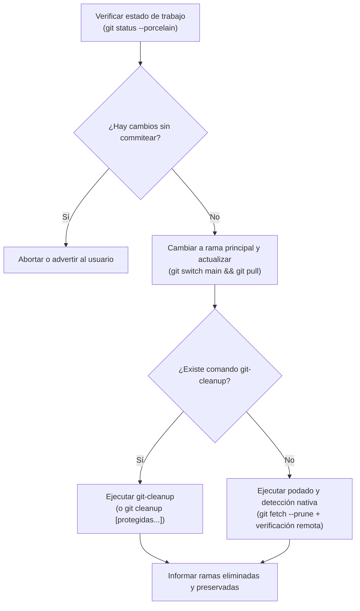

# 🧹 Limpieza e Higiene de Ramas Locales de Git (`git-cleanup`)

## 🎯 Propósito

Eliminar de forma segura las ramas locales de Git que ya fueron fusionadas y borradas de `origin` (especialmente tras **Squash & Merge** en GitHub/GitLab, donde `git branch --merged` falla al comparar commits). Protege siempre las ramas principales (`main`, `master`, `develop`) y cualquier rama configurada como protegida.

## ⚡ Cuándo Activar esta Skill

- Inmediatamente después de fusionar un Pull Request o Merge Request y actualizar `main`.
- Cuando el usuario solicite limpiar o podar ramas locales obsoletas (*"limpia las ramas locales"*, *"borra ramas fusionadas"*, *"haz git cleanup"*).
- Al iniciar una nueva tarea para asegurar un árbol de trabajo limpio sin ramas locales acumuladas.

## 📋 Flujo de Trabajo Paso a Paso



### Paso 1: Asegurar Rama Principal Actualizada

Antes de limpiar cualquier rama, cambia a la rama principal (usualmente `main` o `master`) y actualiza los cambios remotos:

```bash
git switch main
git pull
```

Si estás parado sobre una rama que debe eliminarse, Git no permitirá borrarla mientras esté activa.

### Paso 2: Ejecución de la Limpieza

#### Caso A: Si el comando `git-cleanup` está instalado en el sistema
Ejecuta la herramienta directamente:

```bash
git-cleanup
```

Puedes pasar ramas protegidas adicionales por argumento o consultarlas en la configuración:
```bash
git-cleanup develop staging
```

#### Caso B: Modo Nativo Autónomo (Fallback cuando `git-cleanup` no está instalado)
Si `command -v git-cleanup` devuelve falso, ejecuta el siguiente procedimiento nativo que replica la misma lógica de protección y detección de Squash Merge:

```bash
# 1. Podar referencias remotas eliminadas en origin
git fetch --prune

# 2. Definir lista de ramas protegidas
PROTECTED=("main" "master" "develop" "staging")

# 3. Leer protecciones adicionales desde git config si existen
while IFS= read -r configured; do
  [[ -n "$configured" ]] && PROTECTED+=("$configured")
done < <(git config --get-all cleanup.protected 2>/dev/null || true)

# 4. Inspeccionar ramas locales y eliminar las que no existen en origin
for branch in $(git for-each-ref --format='%(refname:short)' refs/heads/); do
  # Verificar si está protegida
  skip=false
  for excl in "${PROTECTED[@]}"; do
    if [[ "$branch" == "$excl" ]]; then
      skip=true
      break
    fi
  done
  if $skip; then
    continue
  fi

  # Si la rama aún existe en origin, se conserva
  if git show-ref --verify --quiet "refs/remotes/origin/$branch"; then
    continue
  fi

  # Si no existe en origin y no está protegida, eliminarla
  echo "Eliminando rama local obsoleta: $branch"
  git branch -D "$branch"
done
```

### Paso 3: Configurar Ramas Protegidas Permanentes (Opcional)

Si el proyecto maneja ramas de larga duración que no deben borrarse nunca (ej. `release/*`, `develop`):

```bash
# Para el repositorio actual:
git config --add cleanup.protected develop

# Para todos los repositorios del usuario:
git config --global --add cleanup.protected develop
```

## 🛠️ Herramientas Auxiliares

- `git-cleanup`: CLI standalone disponible en la colección de scripts del usuario.
- [`references/branch_hygiene.md`](references/branch_hygiene.md): Guía detallada sobre el problema del Squash Merge, diferencias entre `git branch -d` y `git branch -D`, y buenas prácticas de higiene en Git.

## ⚠️ Reglas Críticas

1. **Nunca Borrar Ramas Principales**:
   - `main`, `master` y `develop` **JAMÁS** deben ser eliminadas.
2. **Siempre Cambiar a `main` Antes de Podar**:
   - Nunca ejecutes la limpieza estando parado en una rama de feature temporal.
3. **Poda Remota Previa Obligatoria (`git fetch --prune`)**:
   - Siempre sincroniza el estado de `origin` antes de evaluar ramas locales; de lo contrario, ramas ya borradas en GitHub aparecerán falsamente como vivas en el caché local.
4. **Verificación de Trabajo No Publicado**:
   - Si una rama nunca tuvo tracking remoto en `origin` y contiene commits locales importantes sin subir, advierte al usuario antes de forzar su borrado con `-D`.

## 📚 Referencias Adicionales

* [Guía de Higiene de Ramas y Squash Merge](references/branch_hygiene.md)
