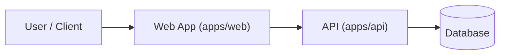
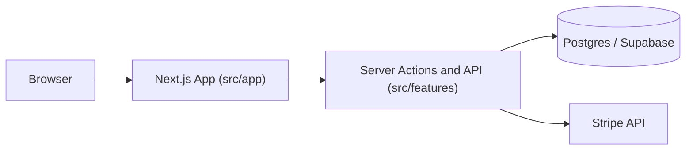

# Architecture Template and Mermaid Rules (`architecture-map`)

Use this template as the base structure when creating the architecture page, and as a reference to sync technical sections when updating an existing one. Write the headings and content in the language of the existing page or, for a new page, the user's language.

---

## 📐 Proportionality by Project Size

| Repo type | What to include | What to omit |
| :--- | :--- | :--- |
| **CLI / small library** | Summary, internal flow diagram, main modules, commands, testing/CI | DB, RLS, cloud deployment or queues if they don't exist |
| **Monolithic app (web or API)** | Summary, layers/modules diagram, stack, data/auth, 1–2 key flows, env vars, deployment | Multi-app table |
| **Monorepo / multi-service** | Summary, apps/packages/services diagram, table of apps and shared packages, data/auth, 2–3 cross-app flows, integrations, CI/deployment per app | File-by-file internal detail |

---

## 🧩 Rules for Mermaid Diagrams

- Use only `flowchart TD` or `flowchart LR` (they work in GitHub, Notion and standard viewers).
- **Quote** any label with parentheses, brackets, colons or slashes: `api["NestJS API (src/apps/api)"]` instead of `api[NestJS API (src/apps/api)]`.
- Avoid HTML tags (`<br/>`, `<b>`) inside nodes.
- Keep between **5 and 15 nodes** so the diagram stays readable; show system boundaries, not every file.

---

## 📄 Canonical Template

```markdown
# Architecture — <Project Name>

> **Last updated:** <YYYY-MM-DD> · **Commit:** `<short-sha>`

## 1. System Summary
<!-- 2–4 lines: what the project does, who uses it and which architectural style it follows (e.g. pnpm monorepo, modular monolith, Node CLI). -->

## 2. High-Level Diagram


## 3. Apps and Modules
| Component | Location | Responsibility | Depends on |
|---|---|---|---|
| `<name>` | `path/` | <what it solves> | `<other modules / external>` |

## 4. Verified Stack
- **Language / Runtime:** …
- **Framework(s):** …
- **Data / ORM:** … *(omit if not applicable)*
- **Testing / Lint:** …

## 5. Data, Auth and Security *(omit what does not apply)*
- **Persistence:** <engine, location of migrations/schema, core entities>
- **Authentication and permissions:** <mechanism, guards/middleware, RLS if present>

## 6. Key Flows
1. **<Main flow name>:** `<entrypoint>` → `<service/use case>` → `<persistence or output>`.

## 7. External Integrations and Environment Variables *(omit if not applicable)*
- **Services:** <Stripe, Resend, S3, etc. with the file where they are integrated>
- **Key variables (names only):** `DATABASE_URL`, `AUTH_SECRET`, …

## 8. Commands and Deployment
- **Development:** `<command>`
- **Tests / Lint:** `<command>`
- **Build / CI / Deployment:** `<verified workflow or platform>`

## 9. Team Decisions and Notes *(preserved manually)*
<!-- Keep ADRs, historical context, known debt or team agreements here, without overwriting them in future updates. -->
```

---

## 📌 Compact Example (Web App + DB)

```markdown
# Architecture — InvoiceFlow

> **Last updated:** 2026-11-19 · **Commit:** `a4f24bc`

## 1. System Summary
Web application for issuing and reconciling B2B invoices. It follows a modular architecture with the Next.js App Router as UI and BFF, backed by Postgres and Supabase Auth/RLS.

## 2. High-Level Diagram


## 3. Apps and Modules
| Component | Location | Responsibility | Depends on |
|---|---|---|---|
| Routes and UI | `src/app/` | App Router pages and layouts | `src/features/*` |
| Billing | `src/features/invoices/` | Creation, filters and CSV export | `src/shared/db/`, Stripe |
| Customers | `src/features/customers/` | Sign-up and tax validation | `src/shared/db/` |
| Shared infra | `src/shared/` | Supabase client, env and helpers | `@supabase/supabase-js` |

## 4. Verified Stack
- **Runtime / Language:** Node.js 22 · TypeScript
- **Framework:** Next.js 15 (App Router) + Tailwind CSS
- **Data / Auth:** Postgres (Supabase) + RLS policies in `supabase/migrations/`
- **Testing / Lint:** Vitest (`pnpm test`), Playwright (`pnpm test:e2e`), Oxlint (`pnpm lint`)

## 5. Key Flows
1. **Payment by webhook:** Stripe sends an event to `src/app/api/webhooks/stripe/route.ts` → verifies the signature → updates the status in `invoices` through `src/features/invoices/mark-paid.ts`.

## 6. External Integrations and Environment Variables
- **Stripe:** payments and webhooks (`src/shared/stripe.ts`).
- **Key variables:** `NEXT_PUBLIC_SUPABASE_URL`, `SUPABASE_SERVICE_ROLE_KEY`, `STRIPE_SECRET_KEY`, `STRIPE_WEBHOOK_SECRET`.

## 7. Commands and Deployment
- **Development:** `pnpm dev` · **Tests:** `pnpm test` · **CI:** `.github/workflows/ci.yml` · **Deploy:** Vercel (`vercel.json`)

## 8. Team Decisions and Notes
- **ADR-001 (manual):** read queries were kept in Server Actions instead of a separate backend until the volume goes over 50k invoices/month.
```
