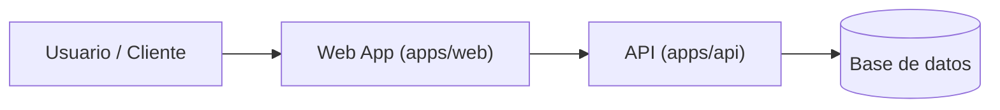
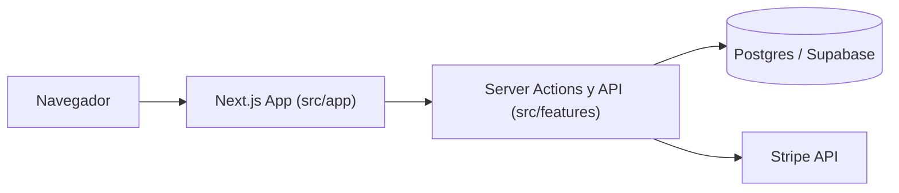

# Plantilla de Arquitectura y Reglas Mermaid (`architecture-map`)

Usa esta plantilla como estructura base al crear la página de arquitectura y como referencia para sincronizar secciones técnicas al actualizar una existente.

---

## 📐 Proporcionalidad por Tamaño del Proyecto

| Tipo de repo | Qué incluir | Qué omitir |
| :--- | :--- | :--- |
| **CLI / Librería pequeña** | Resumen, diagrama de flujo interno, módulos principales, comandos, testing/CI | BD, RLS, despliegue cloud o colas si no existen |
| **App monolítica (web o API)** | Resumen, diagrama de capas/módulos, stack, datos/auth, 1–2 flujos clave, env vars, despliegue | Tabla de múltiples apps |
| **Monorepo / Multi-servicio** | Resumen, diagrama de apps/paquetes/servicios, tabla de apps y paquetes compartidos, datos/auth, 2–3 flujos cross-app, integraciones, CI/despliegue por app | Detalle interno archivo por archivo |

---

## 🧩 Reglas para Diagramas Mermaid

- Usa únicamente `flowchart TD` o `flowchart LR` (son compatibles con GitHub, Notion y visores estándar).
- **Cita entre comillas** cualquier etiqueta con paréntesis, corchetes, dos puntos o barras: `api["API NestJS (src/apps/api)"]` en lugar de `api[API NestJS (src/apps/api)]`.
- Evita etiquetas HTML (`<br/>`, `<b>`) dentro de nodos.
- Mantén entre **5 y 15 nodos** para que el diagrama sea legible; representa límites del sistema, no cada archivo.

---

## 📄 Plantilla Canónica

```markdown
# Arquitectura — <Nombre del Proyecto>

> **Última actualización:** <YYYY-MM-DD> · **Commit:** `<short-sha>`

## 1. Resumen del Sistema
<!-- 2–4 líneas: qué hace el proyecto, quién lo usa y qué estilo arquitectónico sigue (ej. monorepo pnpm, modular monolith, CLI Node). -->

## 2. Diagrama de Alto Nivel


## 3. Apps y Módulos
| Componente | Ubicación | Responsabilidad | Depende de |
|---|---|---|---|
| `<nombre>` | `ruta/` | <qué resuelve> | `<otros módulos / externo>` |

## 4. Stack Verificado
- **Lenguaje / Runtime:** …
- **Framework(s):** …
- **Datos / ORM:** … *(omitir si no aplica)*
- **Testing / Lint:** …

## 5. Datos, Auth y Seguridad *(omitir lo que no aplique)*
- **Persistencia:** <motor, ubicación de migraciones/esquema, entidades centrales>
- **Autenticación y permisos:** <mecanismo, guards/middlewares, RLS si existe>

## 6. Flujos Clave
1. **<Nombre del flujo principal>:** `<entrypoint>` → `<servicio/caso de uso>` → `<persistencia o salida>`.

## 7. Integraciones Externas y Variables de Entorno *(omitir si no aplica)*
- **Servicios:** <Stripe, Resend, S3, etc. con archivo donde se integran>
- **Variables clave (solo nombres):** `DATABASE_URL`, `AUTH_SECRET`, …

## 8. Comandos y Despliegue
- **Desarrollo:** `<comando>`
- **Tests / Lint:** `<comando>`
- **Build / CI / Despliegue:** `<workflow o plataforma verificada>`

## 9. Decisiones y Notas del Equipo *(preservado manualmente)*
<!-- Mantener aquí ADRs, contexto histórico, deuda conocida o acuerdos del equipo sin sobrescribir en futuras actualizaciones. -->
```

---

## 📌 Ejemplo Compacto (App Web + BD)

```markdown
# Arquitectura — FacturaFlow

> **Última actualización:** 2026-11-19 · **Commit:** `a4f24bc`

## 1. Resumen del Sistema
Aplicación web para emisión y conciliación de facturas B2B. Sigue una arquitectura modular con Next.js App Router como interfaz y BFF, respaldada por Postgres y Supabase Auth/RLS.

## 2. Diagrama de Alto Nivel


## 3. Apps y Módulos
| Componente | Ubicación | Responsabilidad | Depende de |
|---|---|---|---|
| Rutas y UI | `src/app/` | Páginas App Router y layouts | `src/features/*` |
| Facturación | `src/features/invoices/` | Creación, filtros y exportación CSV | `src/shared/db/`, Stripe |
| Clientes | `src/features/customers/` | Alta y validación fiscal | `src/shared/db/` |
| Infra compartida | `src/shared/` | Cliente Supabase, env y helpers | `@supabase/supabase-js` |

## 4. Stack Verificado
- **Runtime / Lenguaje:** Node.js 22 · TypeScript
- **Framework:** Next.js 15 (App Router) + Tailwind CSS
- **Datos / Auth:** Postgres (Supabase) + políticas RLS en `supabase/migrations/`
- **Testing / Lint:** Vitest (`pnpm test`), Playwright (`pnpm test:e2e`), Oxlint (`pnpm lint`)

## 5. Flujos Clave
1. **Cobro por webhook:** Stripe envía evento a `src/app/api/webhooks/stripe/route.ts` → verifica firma → actualiza estado en `invoices` vía `src/features/invoices/mark-paid.ts`.

## 6. Integraciones Externas y Variables de Entorno
- **Stripe:** cobros y webhooks (`src/shared/stripe.ts`).
- **Variables clave:** `NEXT_PUBLIC_SUPABASE_URL`, `SUPABASE_SERVICE_ROLE_KEY`, `STRIPE_SECRET_KEY`, `STRIPE_WEBHOOK_SECRET`.

## 7. Comandos y Despliegue
- **Desarrollo:** `pnpm dev` · **Tests:** `pnpm test` · **CI:** `.github/workflows/ci.yml` · **Deploy:** Vercel (`vercel.json`)

## 8. Decisiones y Notas del Equipo
- **ADR-001 (manual):** Se eligió mantener las consultas de lectura en Server Actions en lugar de un backend separado hasta superar 50k facturas/mes.
```
