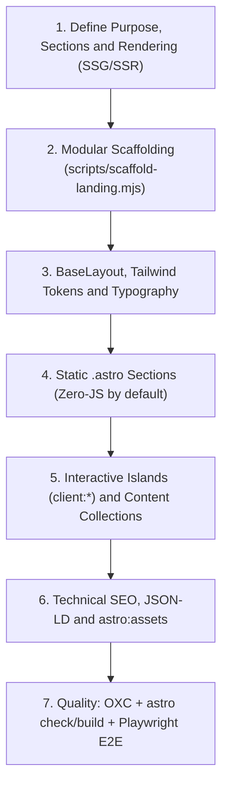

# ⚡ Astro Architecture Standard

## 🎯 Purpose

Standardize the design, structure and build of **Astro** projects (focused mainly on **landing pages**, *marketing sites* and *content-driven* sites) under a **Zero-JS by default**, modular architecture oriented to conversion, technical SEO and Core Web Vitals.

**Assumed stack:** Astro (SSG by default, optional SSR/Hybrid), TypeScript (`strict`), **Tailwind CSS**, **Islands Architecture** (selective hydration), **Content Collections** with Zod, `astro:assets`, **OXC** (`oxlint` / `oxfmt`) and **Playwright** (`@playwright/test`).

---

## ⚡ When to Trigger

- When creating a **landing page** or website from scratch with **Astro**.
- When defining or refactoring the folder structure (`layouts/`, `pages/`, `components/sections/`, `components/ui/`, `content/`, `data/`).
- When deciding which components stay as static `.astro` and which need hydration as islands (`client:*`).
- When configuring `BaseLayout.astro`, SEO metadata (Open Graph, Twitter Cards, canonical, JSON-LD), `sitemap` and `robots.txt`.
- When modeling typed data in `src/data/` or **Content Collections** with Zod schemas.
- When auditing performance (*Zero-JS*), use of `astro:assets`, accessibility (WCAG AA) and types before deploying.

---

## 📋 Workflow



1. **Step 1 — Requirements analysis and rendering mode**:
   - Define the audience, value proposition, primary/secondary CTA and section map (see the [Landing Page Blueprint](references/landing-blueprint.md)).
   - Keep **SSG** (`output: 'static'`) by default; enable SSR/Hybrid only if there are dynamic server routes or stateful `/api/*` endpoints.

2. **Step 2 — Diagnosis or initial scaffolding**:
   - If the project does not have the section structure and base layout yet, preview with `--dry-run` and generate the skeleton:
     ```bash
     node <skill-dir>/scripts/scaffold-landing.mjs --dry-run --target-dir .
     node <skill-dir>/scripts/scaffold-landing.mjs --target-dir . --name "My Product"
     ```
   - The scaffold writes English placeholder copy and `<html lang="en">`; translate `src/data/site.ts`, the markup strings and `lang` if the site is in another language.
   - See the expected structure in the [Structure Example](examples/landing-structure.md).

3. **Step 3 — `BaseLayout.astro` and the visual system with Tailwind CSS**:
   - Centralize `<head>`, fonts, the skip-to-content link, `<Navbar />`, `<main>` and `<Footer />` in `src/layouts/BaseLayout.astro`.
   - Define semantic color, typography and spacing tokens in `src/styles/global.css`.
   - Apply *mobile-first* design, WCAG AA contrast and semantic HTML (`<header>`, `<main>`, `<section>`, `<footer>`, an `<h1>`–`<h3>` hierarchy without gaps).

4. **Step 4 — Building static sections (`.astro`)**:
   - Split components into:
     - `src/components/sections/`: page blocks (`HeroSection.astro`, `FeaturesSection.astro`, `PricingSection.astro`, `FaqSection.astro`, `CtaSection.astro`).
     - `src/components/ui/`: reusable primitives (`Button.astro`, `Badge.astro`, `Card.astro`, `Navbar.astro`, `Footer.astro`).
     - `src/data/`: copy and typed configuration in TypeScript (`site.ts`, `landing.ts`), avoiding hardcoded long text inside the markup.

5. **Step 5 — Interactive islands and Content Collections**:
   - Use `client:*` directives **only** when the component needs client-side state (see [Islands and Rendering](references/islands-and-rendering.md)):
     - Prefer `client:visible` for *below-the-fold* elements (carousels, calculators, interactive forms).
     - Prefer `client:idle` for secondary widgets.
     - Reserve `client:load` for critical *above-the-fold* interactivity only.
     - For accordions (FAQ), simple tabs or mobile menus, prefer native HTML (`<details>`/`<summary>`) or CSS before introducing a JS framework.
   - If there is a blog, case studies, long testimonials or documentation, model them with **Content Collections** + Zod (see [Content Collections and Data](references/content-and-data.md)).

6. **Step 6 — Technical SEO, `astro:assets` and performance**:
   - Use `<Image />` or `<Picture />` from `astro:assets` for optimized local and remote images, with a descriptive `alt` and explicit dimensions (see [SEO and Performance](references/seo-and-performance.md)).
   - Include `<title>`, `<meta name="description">`, `rel="canonical"`, Open Graph, Twitter Cards, JSON-LD Schema (`Organization` / `SoftwareApplication` / `FAQPage`), `sitemap` and `public/robots.txt`.

7. **Step 7 — Final verification (OXC, types, build and Playwright E2E)**:
   - Configure and run **OXC** (`oxlint` / `oxfmt`), type checking, the production build, E2E tests with **Playwright** against `astro preview` and the architecture audit (see [Toolchain and Testing](references/testing-and-toolchain.md)):
     ```bash
     npx oxlint --deny-warnings src/
     npx oxfmt --check .
     npx astro check
     npm run build
     npx playwright test
     node <skill-dir>/scripts/audit-astro.mjs --target-dir .
     ```
   - Confirm zero lint/type errors, a clean build, a green E2E suite and no critical alerts in the audit.

---

## 🛠️ Helper Scripts

> **Paths:** `<skill-dir>` is the directory that holds this `SKILL.md` (e.g. `.claude/skills/astro-architecture/` or `.agents/skills/astro-architecture/`). Run the scripts from the user's project root, not from `<skill-dir>`.

- `scripts/scaffold-landing.mjs`: generates the base modular structure (`BaseLayout.astro`, landing sections, `Navbar`, `Footer`, `src/data/site.ts`, `src/styles/global.css` and `src/pages/index.astro`).
  - Options: `--target-dir <path>` (default `.`), `--name "<Name>"`, `--dry-run` (preview only), `--force` (overwrite existing files).
- `scripts/audit-astro.mjs`: audits the Astro project for a `strict` TypeScript config, `client:load` overuse, unoptimized `` tags, missing basic SEO metadata and `robots.txt`.
  - Options: `--target-dir <path>` (default `.`), `--strict` (exits with a non-zero code on warnings).

---

## ⚠️ Critical Rules

1. **Reply in the user's language**, even though this skill is written in English.
2. **Zero-JS by default:** never add `client:*` directives to components that only render static HTML/CSS.
3. **No `` without a reason:** use `<Image />` or `<Picture />` from `astro:assets` to guarantee `width`, `height`, a modern format (WebP/AVIF) and avoid CLS.
4. **One `<h1>` per page:** the heading hierarchy must be strict (`h1` → `h2` → `h3`) and the main `<h1>` must be in the *above-the-fold* Hero.
5. **Strict TypeScript:** all `Props` of `.astro` components must be declared with `interface Props`, and the files in `src/data/` must be typed.
6. **Do not overwrite without confirmation:** always run `scaffold-landing.mjs` with `--dry-run` first and never use `--force` without confirming with the user.
7. **Relative internal links:** inside this skill, every reference to its own files must be relative to `<skill-dir>` (never absolute paths).

---

## 📚 References and Examples

- [Islands and Rendering (SSG, SSR, client:*)](references/islands-and-rendering.md)
- [Landing Page Section Blueprint](references/landing-blueprint.md)
- [Content Collections, Typed Data and astro:assets](references/content-and-data.md)
- [Technical SEO and Core Web Vitals Checklist](references/seo-and-performance.md)
- [Toolchain and Testing (OXC + Playwright)](references/testing-and-toolchain.md)
- [Structure and Composition Example](examples/landing-structure.md)
