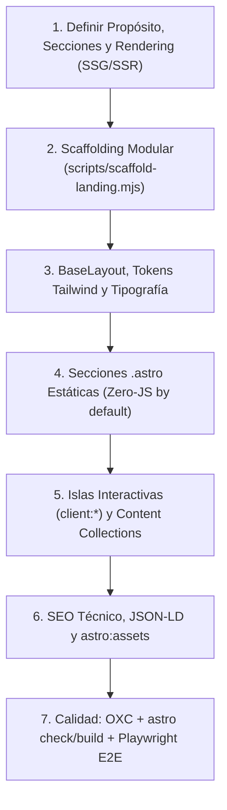

# ⚡ Astro Architecture Standard

## 🎯 Propósito

Estandarizar el diseño, estructuración y construcción de proyectos en **Astro** —con foco principal en **landing pages**, *marketing sites* y sitios *content-driven*— bajo una arquitectura **Zero-JS by default**, modular y orientada a conversión, SEO técnico y Core Web Vitals.

**Stack asumido:** Astro (SSG por defecto, SSR/Hybrid opcional), TypeScript (`strict`), **Tailwind CSS**, **Islands Architecture** (hidratación selectiva), **Content Collections** con Zod, `astro:assets`, **OXC** (`oxlint` / `oxfmt`) y **Playwright** (`@playwright/test`).

---

## ⚡ Cuándo Activar esta Skill

- Al crear una **landing page** o sitio web desde cero con **Astro**.
- Al definir o refactorizar la estructura de carpetas (`layouts/`, `pages/`, `components/sections/`, `components/ui/`, `content/`, `data/`).
- Al decidir qué componentes deben permanecer como `.astro` estáticos y cuáles requieren hidratación como islas (`client:*`).
- Al configurar `BaseLayout.astro`, metadatos SEO (Open Graph, Twitter Cards, canonical, JSON-LD), `sitemap` y `robots.txt`.
- Al modelar datos tipados en `src/data/` o **Content Collections** con esquemas Zod.
- Al auditar rendimiento (*Zero-JS*), uso de `astro:assets`, accesibilidad (WCAG AA) y tipos antes de desplegar.

---

## 📋 Flujo de Trabajo Paso a Paso



1. **Paso 1 — Análisis de requerimientos y modo de renderizado**:
   - Definir audiencia, propuesta de valor, CTA principal/secundario y mapa de secciones (ver [Blueprint de Landing Pages](references/landing-blueprint.md)).
   - Mantener **SSG** (`output: 'static'`) por defecto; activar SSR/Hybrid solo si existen rutas dinámicas en servidor o endpoints `/api/*` con estado.

2. **Paso 2 — Diagnóstico o Scaffolding inicial**:
   - Si el proyecto aún no tiene la estructura de secciones y layout base, previsualizar con `--dry-run` y generar el esqueleto:
     ```bash
     node <skill-dir>/scripts/scaffold-landing.mjs --dry-run --target-dir .
     node <skill-dir>/scripts/scaffold-landing.mjs --target-dir . --name "Mi Producto"
     ```
   - Consultar la estructura esperada en [Ejemplo de Estructura](examples/landing-structure.md).

3. **Paso 3 — `BaseLayout.astro` y sistema visual con Tailwind CSS**:
   - Centralizar `<head>`, fuentes, skip-to-content link, `<Navbar />`, `<main>` y `<Footer />` en `src/layouts/BaseLayout.astro`.
   - Definir tokens semánticos de color, tipografía y espaciado en `src/styles/global.css`.
   - Aplicar diseño *mobile-first*, contraste WCAG AA y HTML semántico (`<header>`, `<main>`, `<section>`, `<footer>`, jerarquía `<h1>`–`<h3>` sin saltos).

4. **Paso 4 — Construcción de secciones estáticas (`.astro`)**:
   - Separar componentes en:
     - `src/components/sections/`: bloques de página (`HeroSection.astro`, `FeaturesSection.astro`, `PricingSection.astro`, `FaqSection.astro`, `CtaSection.astro`).
     - `src/components/ui/`: primitivas reutilizables (`Button.astro`, `Badge.astro`, `Card.astro`, `Navbar.astro`, `Footer.astro`).
     - `src/data/`: copy y configuración tipada en TypeScript (`site.ts`, `landing.ts`), evitando hardcodear textos largos dentro del markup.

5. **Paso 5 — Islas interactivas y Content Collections**:
   - Usar directivas `client:*` **únicamente** cuando el componente requiera estado en cliente (ver [Islas y Renderizado](references/islands-and-rendering.md)):
     - Preferir `client:visible` para elementos *below-the-fold* (carruseles, calculadoras, formularios interactivos).
     - Preferir `client:idle` para widgets secundarios.
     - Reservar `client:load` solo para interactividad crítica *above-the-fold*.
     - Para acordeones (FAQ), tabs simples o menús móviles, priorizar HTML nativo (`<details>`/`<summary>`) o CSS antes de introducir un framework JS.
   - Si hay blog, casos de éxito, testimonios extensos o documentación, modelarlos con **Content Collections** + Zod (ver [Content Collections y Datos](references/content-and-data.md)).

6. **Paso 6 — SEO técnico, `astro:assets` y rendimiento**:
   - Usar `<Image />` o `<Picture />` de `astro:assets` para imágenes locales y remotas optimizadas, definiendo `alt` descriptivo y dimensiones explícitas (ver [SEO y Rendimiento](references/seo-and-performance.md)).
   - Incluir `<title>`, `<meta name="description">`, `rel="canonical"`, Open Graph, Twitter Cards, Schema JSON-LD (`Organization` / `SoftwareApplication` / `FAQPage`), `sitemap` y `public/robots.txt`.

7. **Paso 7 — Verificación final (OXC, tipos, build y Playwright E2E)**:
   - Configurar y ejecutar **OXC** (`oxlint` / `oxfmt`), validación de tipos, build de producción, pruebas E2E con **Playwright** contra `astro preview` y auditoría de arquitectura (ver [Toolchain y Testing](references/testing-and-toolchain.md)):
     ```bash
     npx oxlint --deny-warnings src/
     npx oxfmt --check .
     npx astro check
     npm run build
     npx playwright test
     node <skill-dir>/scripts/audit-astro.mjs --target-dir .
     ```
   - Confirmar cero errores de lint/tipos, build limpio, suite E2E en verde y ausencia de alertas críticas en la auditoría.

---

## 🛠️ Scripts Auxiliares

> **Rutas:** `<skill-dir>` es el directorio que contiene este `SKILL.md` (p. ej. `.claude/skills/astro-architecture/` o `.agents/skills/astro-architecture/`). Ejecuta los scripts desde la raíz del proyecto del usuario, no desde `<skill-dir>`.

- `scripts/scaffold-landing.mjs`: Genera la estructura modular base (`BaseLayout.astro`, secciones de landing, `Navbar`, `Footer`, `src/data/site.ts`, `src/styles/global.css` y `src/pages/index.astro`).
  - Opciones: `--target-dir <ruta>` (por defecto `.`), `--name "<Nombre>"`, `--dry-run` (solo previsualiza), `--force` (sobrescribe archivos existentes).
- `scripts/audit-astro.mjs`: Audita el proyecto Astro buscando configuración `strict` de TypeScript, abuso de `client:load`, etiquetas `` sin optimizar, ausencia de metadatos SEO básicos y `robots.txt`.
  - Opciones: `--target-dir <ruta>` (por defecto `.`), `--strict` (falla con código distinto de 0 ante warnings).

---

## ⚠️ Reglas Críticas

1. **Zero-JS by default:** Nunca añadir directivas `client:*` a componentes que solo renderizan HTML/CSS estático.
2. **Prohibido `` sin justificación:** Usar `<Image />` o `<Picture />` de `astro:assets` para garantizar `width`, `height`, formato moderno (WebP/AVIF) y evitar CLS.
3. **Un solo `<h1>` por página:** La jerarquía de encabezados debe ser estricta (`h1` → `h2` → `h3`) y el `<h1>` principal debe estar en el Hero *above-the-fold*.
4. **TypeScript estricto:** Todas las `Props` de componentes `.astro` deben declararse con `interface Props` y los archivos de `src/data/` deben estar tipados.
5. **No sobrescribir sin confirmación:** Ejecutar siempre `scaffold-landing.mjs` con `--dry-run` primero y nunca usar `--force` sin confirmar con el usuario.
6. **Enlaces relativos internos:** Dentro de esta skill, toda referencia a archivos propios debe ser relativa a `<skill-dir>` (nunca rutas absolutas).

---

## 📚 Referencias y Ejemplos

- [Islas y Renderizado (SSG, SSR, client:*)](references/islands-and-rendering.md)
- [Blueprint de Secciones para Landing Pages](references/landing-blueprint.md)
- [Content Collections, Datos Tipados y astro:assets](references/content-and-data.md)
- [Checklist de SEO Técnico y Core Web Vitals](references/seo-and-performance.md)
- [Toolchain y Testing (OXC + Playwright)](references/testing-and-toolchain.md)
- [Ejemplo de Estructura y Composición](examples/landing-structure.md)
