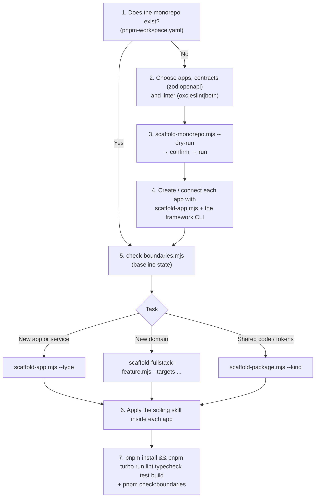

# 🗂️ Monorepo Architecture Standard (pnpm + Turborepo + Multi-App)

## 🎯 Purpose

Standardize monorepos with **pnpm workspaces**, **Turborepo** and **OXC** that can host any combination of applications and services: **Web (`Next.js`)**, **API (`NestJS`)**, **Mobile (`Expo / React Native`)**, **Landing (`Astro`)**, SPAs/Docs, Node.js workers and polyglot services (`services/*`).

It defines the root structure (`apps/`, `packages/`, `services/`), the extensible archetype registry (`APP_PRESETS`), the task pipeline, how internal packages are compiled and consumed per platform, how contracts and design tokens are shared, and how to check boundaries between workspaces and platforms.

The **internal** rules of each app do not change:
- `apps/web` follows [`nextjs-architecture`](../nextjs-architecture/SKILL.md)
- `apps/api` follows [`nestjs-architecture`](../nestjs-architecture/SKILL.md)
- `apps/mobile` follows [`react-native-architecture`](../react-native-architecture/SKILL.md)
- `apps/landing` follows [`astro-architecture`](../astro-architecture/SKILL.md)

This skill governs **the root and everything that connects or separates** the workspaces from each other.

---

## ⚡ When to Trigger This Skill

- When creating a new monorepo (2, 3, 4 or more apps: `web`, `api`, `mobile`, `landing`, `worker`, `spa`, `docs`, `polyglot`).
- When adding a new app or service to an existing monorepo (`scaffold-app.mjs`).
- When creating a shared internal package (`packages/<name>`): `contracts`, `api-client`, `design-tokens`, `ui-web`, `ui-native`, `lib` or `config`.
- When adding an end-to-end domain across `api`, `web` and `mobile` (`scaffold-fullstack-feature.mjs`).
- When deciding what each platform can share (DOM vs React Native vs Node vs Astro) without breaking Metro, SSR or bundles.
- When reviewing imports between workspaces, `workspace:*` dependencies, platform rules or `turbo run` errors.

---

## 📋 Step-by-Step Workflow



1. **Detect the context**: if `pnpm-workspace.yaml` exists, read the root `package.json`, `turbo.json` and the `package.json` files of `apps/*`, `services/*` and `packages/*`. Run `node <skill-dir>/scripts/check-boundaries.mjs` to learn the existing violations before touching code.
2. **Define topology and contracts**: determine which apps the repo will have (`--apps web,api,mobile,landing,...`) and pick the contracts mode with the matrix below. If it is not obvious, ask the user.
3. **New monorepo**: run `scaffold-monorepo.mjs --scope <scope> --contracts <mode> --apps <list> --dry-run`, show the files to generate and run it without `--dry-run` after confirmation.
4. **Connect or add apps**: for each app, use `scaffold-app.mjs <name> --type <preset>` (with `--dry-run` first). Run the framework's official CLI (`create-next-app`, `nest new`, `create-expo-app`, `create astro`, `create vite`) **only after the user confirms**, because it downloads packages. Check that:
   - its `tsconfig.json` extends `@<scope>/tsconfig/<preset>.json`;
   - it declares `"monorepo": { "layer": "app", "type": "<preset>", "platform": "<platform>" }` in `package.json`;
   - it declares `workspace:*` dependencies and keeps its local `@/*` alias pointing to its own `src/`.
5. **New multi-app domain**: `scaffold-fullstack-feature.mjs <noun> [--targets api,web,mobile] --dry-run`, then without `--dry-run`. It generates the contract (Zod mode) and triggers the matching scaffold in `apps/api`, `apps/web` and/or `apps/mobile`. The landing (`apps/landing`) does not use per-domain CRUD features; it consumes `@<scope>/design-tokens`, `@<scope>/contracts` or `@<scope>/api-client` as needed.
6. **Shared code or tokens**: `scaffold-package.mjs <name> --kind <kind>`. First confirm it has at least **two platform-compatible consumers**; never mix DOM UI (`ui-web`) with React Native (`ui-native`).
7. **Verify**: `pnpm install`, `pnpm turbo run lint typecheck test build` (and `format:check` with OXC) and `pnpm check:boundaries`. Do not call the task done with new violations.

### Contracts Matrix: Zod or OpenAPI?

| Situation | Mode | Result |
| :--- | :--- | :--- |
| Same team, new project, TypeScript consumers (`web` / `mobile` / `worker`) that share form validation | **`zod`** | `packages/contracts/src/<nouns>/<noun>.schema.ts` (universal, no framework deps). Used by Web/Mobile/Landing forms and NestJS DTOs (`createZodDto`) |
| The API is consumed by external partners or polyglot services (`services/*`), Swagger is the source of truth, or the API uses `class-validator` | **`openapi`** | `packages/api-client` with types generated by `openapi-typescript` from `/api-json` and a reusable `createApiClient(baseUrl, { getHeaders })` for Web, Astro and Mobile (`SecureStore`) |

> Both modes can coexist if you have internal Zod forms plus external OpenAPI clients. See [shared-packages-and-contracts.md](references/shared-packages-and-contracts.md).

### Supported Repository Archetypes (`APP_PRESETS`)

| Preset (`--type`) | Stack / Associated skill | Platform | Use case |
| :--- | :--- | :--- | :--- |
| `web` | Next.js App Router ([`nextjs-architecture`](../nextjs-architecture/SKILL.md)) | `web` | Main app, SaaS dashboard, SSR/RSC portal |
| `api` | NestJS Modular Monolith ([`nestjs-architecture`](../nestjs-architecture/SKILL.md)) | `node` | REST/GraphQL backend, business rules and DB |
| `mobile` | React Native + Expo Router ([`react-native-architecture`](../react-native-architecture/SKILL.md)) | `native` | iOS/Android mobile app with Metro configured |
| `landing` | Astro ([`astro-architecture`](../astro-architecture/SKILL.md)) | `astro` | Marketing site, Zero-JS landing, blog/SEO |
| `spa` | Vite + React SPA | `web` | Backoffice or admin without SSR |
| `docs` | Astro Starlight / Docs | `astro` | Product/API technical documentation |
| `worker` | Node.js + TypeScript | `node` | Queues, cron jobs, CLIs, async processors |
| `polyglot` | Python / Go / Rust (`services/*`) | `node` | ML/AI/high-concurrency microservices via a shim + OpenAPI |

How to register new stacks: [monorepo-structure-guide.md](references/monorepo-structure-guide.md#6-extending-with-new-repo-types).

---

## ⚠️ Critical Rules

1. **Reply in the user's language**, even though this skill is written in English.
2. **Apps and services are leaves**: no workspace imports an app or a service (`apps/*`, `services/*`). Apps communicate **only over HTTP / queues / OpenAPI**, never by importing each other's source code.
3. **Packages never import from `apps/` or `services/`**, and they do not form cycles among themselves.
4. **Strict per-platform isolation (`platform-mismatch`)**:
   - `universal` (`contracts`, `api-client`, `design-tokens`, `lib`): only framework-agnostic TypeScript; **forbidden** to import `react`, `react-dom`, `react-native`, `next`, `astro` or `@nestjs/*`.
   - `native` (`apps/mobile`, `ui-native`): **forbidden** to import `web` packages (`ui-web`, `react-dom`).
   - `node` (`apps/api`, `worker`): **forbidden** to import `web`, `astro` or `native` packages.
   - `web` (`apps/web`, `spa`, `ui-web`) and `astro` (`apps/landing`, `docs`): **forbidden** to import `native` or server/ORM `node` packages.
5. **Imports by package name and only through `exports`**: `import { createInvoiceSchema } from '@acme/contracts/invoices'`. It is forbidden to leave the workspace with relative paths (`../../packages/...`) or to deep-import into `src/` or `dist/`.
6. **Internal dependencies declared** as `"@<scope>/<pkg>": "workspace:*"` in each consumer's `package.json`.
7. **Packages compiled to `dist/`**: every compilable package compiles with `tsc` to `dist/`, exposes `exports` pointing to `dist/` and orders builds with `dependsOn: ["^build"]` in `turbo.json`. In Expo (`mobile`), keep `metro.config.js` with `watchFolders` and `unstable_enablePackageExports = true`.
8. **Leaf-folder barrel policy**: `packages/contracts/src/` groups folders by domain and has **no** `index.ts`; each `src/<nouns>/` does, and is exposed as `"./<nouns>"` in `exports`.
9. **Actions with external effects require confirmation**: `pnpm install`, framework CLIs (`create-next-app`, `nest new`, `create-expo-app`, `create astro`, `create vite`), `pnpm add`, or regenerating `api-client` against a live API. Use `--dry-run` first in every scaffold.
10. **Never `--force` on an existing repo without reviewing the diff**: in existing repos, migrate step by step following [monorepo-structure-guide.md](references/monorepo-structure-guide.md).

---

## 🛠️ Helper Scripts and Tools

> **Paths:** `<skill-dir>` is the directory that holds this `SKILL.md` (e.g. `.claude/skills/<name>/` or `.agents/skills/<name>/`). Run the scripts from the root of the user's monorepo, not from `<skill-dir>`.

> **Safety:** the scaffolds abort without writing anything if any of the files they generate already exists. Run them with `--dry-run` first. Use `--force` only with the user's explicit confirmation.

### 1. Monorepo root
```bash
node <skill-dir>/scripts/scaffold-monorepo.mjs --scope <scope> --contracts <zod|openapi> [--apps web,api,mobile,landing] [--linter oxc|eslint|both] [--pnpm-version <x.y.z>] [--dry-run] [--force]
```
Generates the root (`package.json`, `pnpm-workspace.yaml`, `turbo.json`, `.npmrc`, `.gitignore`), `packages/tsconfig` (8 presets), `packages/oxc-config` and/or `packages/eslint-config`, the contracts package and `scripts/check-boundaries.mjs`.

### 2. Add or connect an app / service
```bash
node <skill-dir>/scripts/scaffold-app.mjs <name> --type <web|api|mobile|landing|spa|docs|worker|polyglot> [--dir <path>] [--scope <scope>] [--linter oxc|eslint|both] [--dry-run] [--force]
```
Generates `package.json` (`monorepo.platform`, scripts and `workspace:*`), `tsconfig.json`, the OXC/ESLint config, `metro.config.js` in `mobile`, a starter in `worker`, or a Turborepo shim in `services/<name>` for `polyglot`.

### 3. Shared internal package
```bash
node <skill-dir>/scripts/scaffold-package.mjs <name> [--kind lib|contracts|api-client|design-tokens|ui-web|ui-native|config] [--linter oxc|eslint|both] [--scope <scope>] [--dry-run] [--force]
```

### 4. Full-stack / cross-platform feature
```bash
node <skill-dir>/scripts/scaffold-fullstack-feature.mjs <noun-singular> [--targets api,web,mobile] [--contracts zod|openapi] [--plural <name>] [--api-dir apps/api] [--web-dir apps/web] [--mobile-dir apps/mobile] [--dry-run] [--force]
```
- Orchestrates `nestjs-architecture`, `nextjs-architecture` and `react-native-architecture` (according to `--targets` or the detected directories).
- Runs `--dry-run` on every part before writing: if one fails, nothing is written.

### 5. Boundary and platform validator
```bash
node <skill-dir>/scripts/check-boundaries.mjs [--root .] [--apps-dir apps,services] [--json]
```
Detects (in `.ts`, `.tsx`, `.js`, `.mjs`, `.cjs` and the frontmatter/scripts of `.astro`) with `file:line` and exit 1:
- `app-import`, `package-imports-app`, `relative-escape`, `undeclared`, `deep-import`, `cycle` and `platform-mismatch`.

---

## 📚 Additional References

- [Monorepo Structure Guide](references/monorepo-structure-guide.md): the `web + api + mobile + landing` tree, presets and extending to new stacks/polyglot services.
- [Turborepo and pnpm Workspaces](references/turborepo-and-pnpm.md): Metro + pnpm for Expo, Astro, `turbo.json`, caching, filters and environment variables.
- [Shared Packages and Contracts](references/shared-packages-and-contracts.md): compilation, ESM/CJS, `design-tokens`, `ui-web` vs `ui-native`, cross-platform Zod and OpenAPI.
- [Boundaries and Dependencies](references/boundaries-and-dependencies.md): validator rules (including `platform-mismatch` and `.astro`) and CI.
- [Workflow Examples](examples/workflows.md): a 4-app monorepo, adding mobile/worker/polyglot, and a cross-platform feature.
