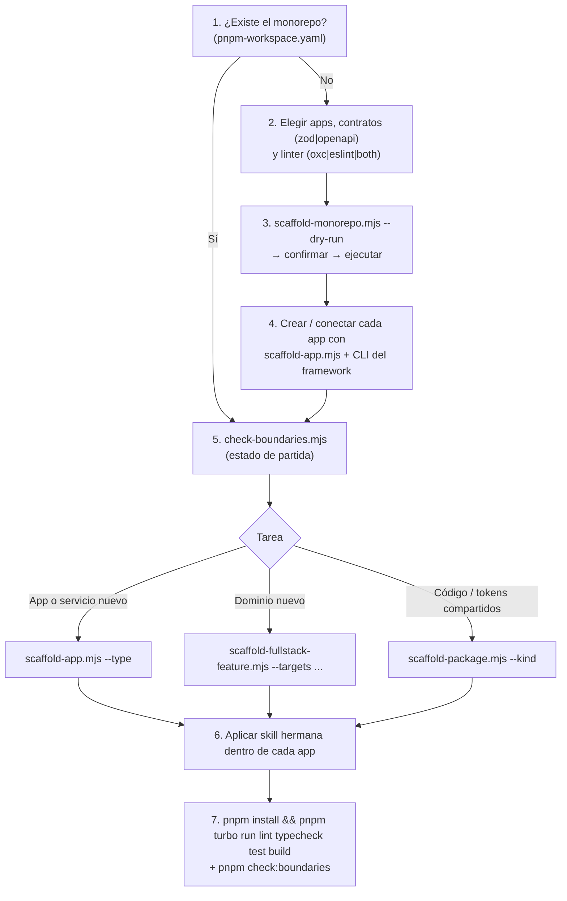

# 🗂️ Monorepo Architecture Standard (pnpm + Turborepo + Multi-App)

## 🎯 Propósito

Estandarizar monorepos con **pnpm workspaces**, **Turborepo** y **OXC** capaces de alojar cualquier combinación de aplicaciones y servicios: **Web (`Next.js`)**, **API (`NestJS`)**, **Mobile (`Expo / React Native`)**, **Landing (`Astro`)**, SPAs/Docs, workers Node.js y servicios políglotas (`services/*`).

Define la estructura raíz (`apps/`, `packages/`, `services/`), el registro extensible de arquetipos (`APP_PRESETS`), el pipeline de tareas, cómo se compilan y consumen los paquetes internos por plataforma, cómo se comparten contratos y design tokens, y cómo verificar límites entre workspaces y plataformas.

Las reglas **internas** de cada app no cambian:
- `apps/web` sigue [`nextjs-architecture`](../nextjs-architecture/SKILL.md)
- `apps/api` sigue [`nestjs-architecture`](../nestjs-architecture/SKILL.md)
- `apps/mobile` sigue [`react-native-architecture`](../react-native-architecture/SKILL.md)
- `apps/landing` sigue [`astro-architecture`](../astro-architecture/SKILL.md)

Esta skill gobierna **la raíz y todo lo que conecta o separa** los workspaces entre sí.

---

## ⚡ Cuándo Activar esta Skill

- Al crear un monorepo nuevo (2, 3, 4 o más apps: `web`, `api`, `mobile`, `landing`, `worker`, `spa`, `docs`, `polyglot`).
- Al añadir una app o servicio nuevo a un monorepo existente (`scaffold-app.mjs`).
- Al crear un paquete interno compartido (`packages/<name>`): `contracts`, `api-client`, `design-tokens`, `ui-web`, `ui-native`, `lib` o `config`.
- Al añadir un dominio de punta a punta entre `api`, `web` y `mobile` (`scaffold-fullstack-feature.mjs`).
- Al decidir qué puede compartir cada plataforma (DOM vs React Native vs Node vs Astro) sin romper Metro, SSR ni bundles.
- Al revisar imports entre workspaces, dependencias `workspace:*`, reglas de plataforma o errores de `turbo run`.

---

## 📋 Flujo de Trabajo Paso a Paso



1. **Detecta el contexto**: si existe `pnpm-workspace.yaml`, lee `package.json` raíz, `turbo.json` y los `package.json` de `apps/*`, `services/*` y `packages/*`. Ejecuta `node <skill-dir>/scripts/check-boundaries.mjs` para conocer las violaciones previas antes de tocar código.
2. **Define topología y contratos**: determina qué apps tendrá el repo (`--apps web,api,mobile,landing,...`) y elige el modo de contratos con la matriz de abajo. Si no es evidente, pregunta al usuario.
3. **Monorepo nuevo**: ejecuta `scaffold-monorepo.mjs --scope <scope> --contracts <modo> --apps <lista> --dry-run`, muestra los archivos a generar y ejecútalo sin `--dry-run` tras confirmar.
4. **Conectar o añadir apps**: para cada app, usa `scaffold-app.mjs <name> --type <preset>` (con `--dry-run` primero). Ejecuta el CLI oficial del framework (`create-next-app`, `nest new`, `create-expo-app`, `create astro`, `create vite`) **solo tras confirmación** del usuario, porque descarga paquetes. Verifica que:
   - su `tsconfig.json` extienda `@<scope>/tsconfig/<preset>.json`;
   - declare `"monorepo": { "layer": "app", "type": "<preset>", "platform": "<platform>" }` en `package.json`;
   - declare dependencias `workspace:*` y mantenga su alias local `@/*` hacia su propio `src/`.
5. **Dominio nuevo multi-app**: `scaffold-fullstack-feature.mjs <noun> [--targets api,web,mobile] --dry-run`, y luego sin `--dry-run`. Genera el contrato (modo Zod) y dispara el scaffold correspondiente en `apps/api`, `apps/web` y/o `apps/mobile`. La landing (`apps/landing`) no usa features CRUD por dominio; consume `@<scope>/design-tokens`, `@<scope>/contracts` o `@<scope>/api-client` según necesite.
6. **Código o tokens compartidos**: `scaffold-package.mjs <name> --kind <kind>`. Confirma antes que tiene al menos **dos consumidores compatibles en plataforma**; nunca mezcles UI DOM (`ui-web`) con React Native (`ui-native`).
7. **Verifica**: `pnpm install`, `pnpm turbo run lint typecheck test build` (y `format:check` con OXC) y `pnpm check:boundaries`. No des la tarea por terminada con violaciones nuevas.

### Matriz de Contratos: ¿Zod u OpenAPI?

| Situación | Modo | Resultado |
| :--- | :--- | :--- |
| Mismo equipo, proyecto nuevo, consumidores TypeScript (`web` / `mobile` / `worker`) que comparten validación de formularios | **`zod`** | `packages/contracts/src/<nouns>/<noun>.schema.ts` (universal, sin deps de framework). Usado por formularios Web/Mobile/Landing y DTOs de NestJS (`createZodDto`) |
| La API la consumen partners externos, servicios políglotas (`services/*`), Swagger es la fuente de verdad o la API usa `class-validator` | **`openapi`** | `packages/api-client` con tipos generados por `openapi-typescript` desde `/api-json` y `createApiClient(baseUrl, { getHeaders })` reutilizable en Web, Astro y Mobile (`SecureStore`) |

> Ambos modos pueden convivir si hay formularios Zod internos y además clientes externos OpenAPI. Ver [shared-packages-and-contracts.md](references/shared-packages-and-contracts.md).

### Arquetipos de Repositorio Soportados (`APP_PRESETS`)

| Preset (`--type`) | Stack / Skill asociada | Plataforma | Caso de uso |
| :--- | :--- | :--- | :--- |
| `web` | Next.js App Router ([`nextjs-architecture`](../nextjs-architecture/SKILL.md)) | `web` | App principal, dashboard SaaS, portal SSR/RSC |
| `api` | NestJS Modular Monolith ([`nestjs-architecture`](../nestjs-architecture/SKILL.md)) | `node` | Backend REST/GraphQL, reglas de negocio y DB |
| `mobile` | React Native + Expo Router ([`react-native-architecture`](../react-native-architecture/SKILL.md)) | `native` | App móvil iOS/Android con Metro configurado |
| `landing` | Astro ([`astro-architecture`](../astro-architecture/SKILL.md)) | `astro` | Marketing site, landing Zero-JS, blog/SEO |
| `spa` | Vite + React SPA | `web` | Backoffice o admin sin SSR |
| `docs` | Astro Starlight / Docs | `astro` | Documentación técnica de producto/API |
| `worker` | Node.js + TypeScript | `node` | Colas, cron jobs, CLIs, procesadores asíncronos |
| `polyglot` | Python / Go / Rust (`services/*`) | `node` | Microservicios ML/IA/alta concurrencia vía shim + OpenAPI |

Cómo registrar nuevos stacks: [monorepo-structure-guide.md](references/monorepo-structure-guide.md#6-extender-con-nuevos-tipos-de-repo).

---

## ⚠️ Reglas Críticas

1. **Las apps y servicios son hojas**: ningún workspace importa una app ni un servicio (`apps/*`, `services/*`). Las apps se comunican **solo por HTTP / colas / OpenAPI**, nunca importando código fuente entre sí.
2. **Los paquetes nunca importan de `apps/` ni `services/`**, y no forman ciclos entre sí.
3. **Aislamiento estricto por plataforma (`platform-mismatch`)**:
   - `universal` (`contracts`, `api-client`, `design-tokens`, `lib`): solo código TypeScript agnóstico; **prohibido** importar `react`, `react-dom`, `react-native`, `next`, `astro` o `@nestjs/*`.
   - `native` (`apps/mobile`, `ui-native`): **prohibido** importar paquetes `web` (`ui-web`, `react-dom`).
   - `node` (`apps/api`, `worker`): **prohibido** importar paquetes `web`, `astro` o `native`.
   - `web` (`apps/web`, `spa`, `ui-web`) y `astro` (`apps/landing`, `docs`): **prohibido** importar paquetes `native` o `node` de servidor/ORM.
4. **Imports por nombre de paquete y solo vía `exports`**: `import { createInvoiceSchema } from '@acme/contracts/invoices'`. Prohibido salir del workspace con rutas relativas (`../../packages/...`) o hacer imports profundos a `src/` o `dist/`.
5. **Dependencias internas declaradas** con `"@<scope>/<pkg>": "workspace:*"` en el `package.json` de cada consumidor.
6. **Paquetes compilados a `dist/`**: todo paquete compilable compila con `tsc` a `dist/`, expone `exports` apuntando a `dist/` y ordena builds con `dependsOn: ["^build"]` en `turbo.json`. En Expo (`mobile`), mantén `metro.config.js` con `watchFolders` y `unstable_enablePackageExports = true`.
7. **Política de barrels de hoja terminal**: `packages/contracts/src/` agrupa carpetas por dominio y **no** lleva `index.ts`; cada `src/<nouns>/` sí, y se expone como `"./<nouns>"` en `exports`.
8. **Acciones con efectos externos requieren confirmación**: `pnpm install`, CLIs de frameworks (`create-next-app`, `nest new`, `create-expo-app`, `create astro`, `create vite`), `pnpm add`, o regenerar `api-client` contra una API viva. Usa `--dry-run` primero en todos los scaffolds.
9. **Nunca `--force` sobre un repo existente sin revisar el diff**: en repos existentes, migra paso a paso siguiendo [monorepo-structure-guide.md](references/monorepo-structure-guide.md).

---

## 🛠️ Scripts y Herramientas Auxiliares

> **Rutas:** `<skill-dir>` es el directorio que contiene este `SKILL.md` (p. ej. `.claude/skills/<name>/` o `.agents/skills/<name>/`). Ejecuta los scripts desde la raíz del monorepo del usuario, no desde `<skill-dir>`.

> **Seguridad:** los scaffolds abortan sin escribir nada si alguno de los archivos que generan ya existe. Ejecuta primero con `--dry-run`. Usa `--force` solo con confirmación explícita del usuario.

### 1. Raíz del monorepo
```bash
node <skill-dir>/scripts/scaffold-monorepo.mjs --scope <scope> --contracts <zod|openapi> [--apps web,api,mobile,landing] [--linter oxc|eslint|both] [--pnpm-version <x.y.z>] [--dry-run] [--force]
```
Genera raíz (`package.json`, `pnpm-workspace.yaml`, `turbo.json`, `.npmrc`, `.gitignore`), `packages/tsconfig` (8 presets), `packages/oxc-config` y/o `packages/eslint-config`, paquete de contratos y `scripts/check-boundaries.mjs`.

### 2. Añadir o conectar una app / servicio
```bash
node <skill-dir>/scripts/scaffold-app.mjs <name> --type <web|api|mobile|landing|spa|docs|worker|polyglot> [--dir <path>] [--scope <scope>] [--linter oxc|eslint|both] [--dry-run] [--force]
```
Genera `package.json` (`monorepo.platform`, scripts y `workspace:*`), `tsconfig.json`, config de OXC/ESLint, `metro.config.js` en `mobile`, starter en `worker` o shim Turborepo en `services/<name>` para `polyglot`.

### 3. Paquete interno compartido
```bash
node <skill-dir>/scripts/scaffold-package.mjs <name> [--kind lib|contracts|api-client|design-tokens|ui-web|ui-native|config] [--linter oxc|eslint|both] [--scope <scope>] [--dry-run] [--force]
```

### 4. Feature full-stack / cross-platform
```bash
node <skill-dir>/scripts/scaffold-fullstack-feature.mjs <noun-singular> [--targets api,web,mobile] [--contracts zod|openapi] [--plural <name>] [--api-dir apps/api] [--web-dir apps/web] [--mobile-dir apps/mobile] [--dry-run] [--force]
```
- Orquesta `nestjs-architecture`, `nextjs-architecture` y `react-native-architecture` (según `--targets` o los directorios detectados).
- Ejecuta `--dry-run` en todas las partes antes de escribir: si falla una, no escribe nada.

### 5. Validador de límites y plataformas
```bash
node <skill-dir>/scripts/check-boundaries.mjs [--root .] [--apps-dir apps,services] [--json]
```
Detecta (en `.ts`, `.tsx`, `.js`, `.mjs`, `.cjs` y frontmatter/scripts de `.astro`) con `archivo:línea` y exit 1:
- `app-import`, `package-imports-app`, `relative-escape`, `undeclared`, `deep-import`, `cycle` y `platform-mismatch`.

---

## 📚 Referencias Adicionales

- [Guía de Estructura del Monorepo](references/monorepo-structure-guide.md): árbol `web + api + mobile + landing`, presets y extensión a nuevos stacks/políglotas.
- [Turborepo y pnpm Workspaces](references/turborepo-and-pnpm.md): Metro + pnpm para Expo, Astro, `turbo.json`, caché, filtros y variables de entorno.
- [Paquetes Compartidos y Contratos](references/shared-packages-and-contracts.md): compilación, ESM/CJS, `design-tokens`, `ui-web` vs `ui-native`, Zod y OpenAPI cross-platform.
- [Límites y Dependencias](references/boundaries-and-dependencies.md): reglas del validador (incluyendo `platform-mismatch` y `.astro`) y CI.
- [Ejemplos de Flujos](examples/workflows.md): monorepo 4-apps, añadir mobile/worker/políglota y feature cross-platform.
