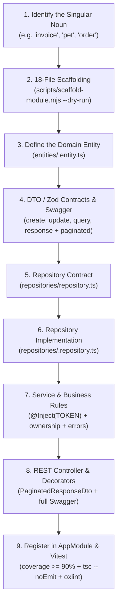

# 🏛️ NestJS Modular Monolith Architecture Standard

## 🎯 Purpose

Standardize the design, modularization and build of **NestJS 12+** backends under the **Modular Monolith** pattern and clean architecture. It adopts the modern high-performance toolchain (**`NodeAdapter`** over `node:http`, **SWC** compilation, **Vitest** tests and **OXC** linting/formatting), strict domain isolation (`src/modules/<nouns>/`), DTO/Zod contracts with pagination and Swagger OpenAPI, ORM-agnostic persistence through Repository/Entity, and a double security barrier (RBAC + ownership).

---

## ⚡ When to Trigger This Skill

- When creating, reviewing or refactoring a business module inside `src/modules/<nouns>/`.
- When configuring the NestJS 12 bootstrap (`NodeAdapter`), SWC compilation, Vitest (`unplugin-swc`) or OXC (`oxlint`/`oxfmt`).
- When generating the full 18-file scaffold of a module (Entity, DTOs, Repository Contract & Impl, Service, Controller, Specs and Module).
- When implementing paginated REST controllers with Swagger documentation (`@ApiTags`, `@ApiOperation`, `@ApiOkResponse`, etc.).
- When structuring validation DTOs with `class-validator` or `nestjs-zod` and a global `ValidationPipe`.
- When designing repositories decoupled from the ORM (`repository.ts` + `<noun>.repository.ts`) or ORM-agnostic transactions.
- When implementing authorization: global `JwtAuthGuard` + `RolesGuard` and ownership checks in services.

> **Monorepo:** if the API lives in a monorepo (`apps/api`), these rules apply inside `apps/api/src/`. For the root structure, shared packages, web/API contracts and dependency boundaries, also use [`monorepo-architecture`](../monorepo-architecture/SKILL.md). In Zod mode use `--target-dir apps/api/src/modules --contracts zod --scope <scope>`.

---

## 📋 Step-by-Step Workflow



### Standard Stack (NestJS 12+)

- **HTTP Platform:** `NodeAdapter` (`@nestjs/platform-node`) in `src/main.ts` as the default adapter over `node:http`.
- **Compilation:** **SWC** (`"builder": "swc"` in `nest-cli.json`) for fast builds; `tsc --noEmit` for type checking in parallel/CI.
- **Testing:** **Vitest** with `unplugin-swc` (`legacyDecorator: true`, `decoratorMetadata: true`) and `vite-tsconfig-paths`. (Optional `--test-runner jest` support for existing projects.)
- **Linter / Formatter:** **OXC** (`oxlint` and `oxfmt`). Format before sorting imports with `ts-import-organizer`.

### Mandatory Scaffolding Sequence (18 Files in Order)

1. `src/modules/<nouns>/entities/<noun>.entity.ts`: immutable class with `readonly` fields and a typed `static fromPersistence()` without `any`.
2. `src/modules/<nouns>/entities/index.ts`: re-export of the entity.
3. `src/modules/<nouns>/dto/create-<noun>.dto.ts`: validation with `class-validator` + `@ApiProperty` (or `createZodDto` with `--contracts zod`).
4. `src/modules/<nouns>/dto/update-<noun>.dto.ts`: `PartialType(OmitType(Create<Noun>Dto, [] as const))` (or `createZodDto(updateSchema)`).
5. `src/modules/<nouns>/dto/find-<nouns>-query.dto.ts`: pagination (`page`, `limit`) and sanitized filters.
6. `src/modules/<nouns>/dto/<noun>-response.dto.ts`: `<Noun>ResponseDto` (`fromEntity`) and `Paginated<Noun>ResponseDto` (`fromPaginatedResult`).
7. `src/modules/<nouns>/dto/index.ts`: re-export of all DTOs.
8. `src/modules/<nouns>/repositories/repository.ts`: the `I<Noun>Repository` contract and the `<NOUN>_REPOSITORY_TOKEN` token.
9. `src/modules/<nouns>/repositories/<noun>.repository.ts`: the `<Noun>Repository implements I<Noun>Repository` implementation.
10. `src/modules/<nouns>/repositories/<noun>.repository.spec.ts`: unit tests for the `fromPersistence()` mapping and queries.
11. `src/modules/<nouns>/repositories/index.ts`: re-export of the contract and the implementation.
12. `src/modules/<nouns>/services/<noun>.service.ts`: injects `@Inject(<NOUN>_REPOSITORY_TOKEN) private readonly repo: I<Noun>Repository`.
13. `src/modules/<nouns>/services/<noun>.service.spec.ts`: tests for happy paths, `NotFoundException` and `ForbiddenException`.
14. `src/modules/<nouns>/services/index.ts`: re-export of the service.
15. `src/modules/<nouns>/controllers/<noun>.controller.ts`: endpoints with full Swagger that return only Response DTOs (and the paginated envelope in `findAll`).
16. `src/modules/<nouns>/controllers/<noun>.controller.spec.ts`: tests for delegation and transformation into DTOs.
17. `src/modules/<nouns>/controllers/index.ts`: re-export of the controller.
18. `src/modules/<nouns>/<noun>.module.ts`: `@Module` binding the token and exporting **only** `<Noun>Service`.

---

## ⚠️ Critical Rules

1. **Reply in the user's language**, even though this skill is written in English.
2. **Dependency Inversion in Repositories (DIP) and Encapsulation:**
   - The service injects only the `I<Noun>Repository` interface through `@Inject(<NOUN>_REPOSITORY_TOKEN)` (using `import type` for the interface under SWC/TS).
   - `<Noun>Module` exports **only `<Noun>Service`**, **NEVER** `<NOUN>_REPOSITORY_TOKEN` or `<Noun>Repository`. Modules communicate only through exported services or domain events (`forwardRef()` is forbidden).
3. **Strict Response DTOs and Full Pagination:**
   - Every endpoint returns `<Noun>ResponseDto` or `Paginated<Noun>ResponseDto` (`{ items, total, page, limit }`).
   - **FORBIDDEN:** returning domain entities or ORM models, or dropping pagination metadata in listings.
4. **Full Isolation of the ORM / Database:**
   - No ORM is imported in controllers or services. The repository always returns immutable domain entities and translates persistence errors (e.g. unique constraint → `ConflictException`).
5. **Zero `any`, Strict `import type` and a Global `ValidationPipe`:**
   - `any` is forbidden in entities, DTOs, repositories and controllers. Use `import type` for pure types for compatibility with SWC and `oxlint`.
   - Configure a global `ValidationPipe` with `whitelist: true`, `forbidNonWhitelisted: true` and `transform: true`.
6. **Naming and the Leaf-Folder Barrel Policy:**
   - Module folder in **plural** `kebab-case` (exception: `auth`); internal files in **singular**.
   - `src/modules/<nouns>/` **NEVER** has an `index.ts`. Only the leaf subfolders (`controllers/`, `dto/`, `entities/`, `repositories/`, `services/`) have an `index.ts`.
7. **Double Authorization Barrier (RBAC + Ownership):**
   - Barrier 1: `JwtAuthGuard` followed by `RolesGuard`, registered as `APP_GUARD`, + `@Roles(...)` / `@Public()` and `@CurrentUser()`. Never use fallbacks such as `req.user?.id || 'anonymous'`.
   - Barrier 2: the service sets `ownerId: requesterId` in `create`, filters by `ownerId` in `findAll` for non-admins, and checks ownership in `findOne`/`update`/`remove`, throwing `ForbiddenException`.
8. **Exhaustive Swagger:**
   - Include `@ApiOperation`, `@ApiOkResponse` / `@ApiCreatedResponse` / `@ApiNoContentResponse`, `@ApiParam` with `format: 'uuid'`, `@ApiBadRequestResponse`, `@ApiUnauthorizedResponse` and `@ApiForbiddenResponse`.
9. **Test Coverage $\ge 90\%$ with Vitest, and Exclusions:**
   - Test branches, errors (`404`, `403`, `409`) and the `fromPersistence`/`fromEntity` mappings.
   - Exclude from coverage in `vitest.config.ts` / Jest: `src/config/**`, `src/main.ts`, `**/*.module.ts`, `**/*.dto.ts` and `**/index.ts`.

---

## 📚 References

- [Modular Monolith and Stack Guide (NodeAdapter + SWC + OXC)](references/modular-monolith-guide.md): NestJS 12 bootstrap, `nest-cli.json` with SWC, `oxlint`/`oxfmt`, the global `src/` structure and inter-module communication.
- [DTO, Zod and Swagger OpenAPI Standards](references/dto-and-swagger-standards.md): `ValidationPipe`, `ClassSerializerInterceptor`, `PaginatedResponseDto`, `nestjs-zod` and the Swagger checklist.
- [Repository and Domain Entity Pattern](references/repository-and-entity-pattern.md): Prisma/TypeORM/Drizzle adapters, `fromPersistence` mappers, transactions/Unit of Work and error mapping.
- [RBAC and Ownership Validation Strategy](references/rbac-and-ownership.md): `APP_GUARD` order, `@CurrentUser()`, a shared `Role`, filtering in `findAll` and HTTP exceptions.
- [Testing Strategy (Vitest + SWC + E2E)](references/testing-strategy.md): `vitest.config.ts` setup with `unplugin-swc`, unit tests, E2E with Supertest and coverage exclusions.
- [Workflow and Refactoring Examples](examples/workflows.md): refactoring a *Fat Controller* and decoupled communication between modules.

---

## 🛠️ Scripts

> **Paths:** `<skill-dir>` is the directory that holds this `SKILL.md` (e.g. `.claude/skills/<name>/` or `.agents/skills/<name>/`). Run the scripts from the user's project root, not from `<skill-dir>`.

> **Safety:** the script aborts without writing anything if any of the files it generates already exists. Run it with `--dry-run` first to preview. Use `--force` only with the user's explicit confirmation.

### Generate a Full NestJS Module (18 files)

```bash
node <skill-dir>/scripts/scaffold-module.mjs <noun-singular> [--target-dir <path>] [--plural <name>] [--orm custom|prisma|typeorm|drizzle] [--contracts class-validator|zod] [--scope <scope>] [--test-runner vitest|jest] [--dry-run] [--force]
```

*Examples:*
- `node <skill-dir>/scripts/scaffold-module.mjs invoice --target-dir src/modules --orm prisma --dry-run`
- `node <skill-dir>/scripts/scaffold-module.mjs invoice --target-dir apps/api/src/modules --contracts zod --scope acme`
