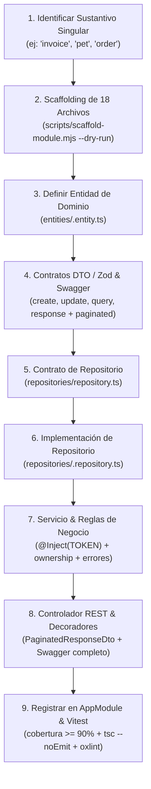

# 🏛️ NestJS Modular Monolith Architecture Standard

## 🎯 Propósito

Estandarizar el diseño, modularización y construcción de backends en **NestJS 12+** bajo el patrón **Modular Monolith (Monolito Modular)** y arquitectura limpia. Adopta el toolchain moderno de alto rendimiento (**`NodeAdapter`** sobre `node:http`, compilación con **SWC**, pruebas con **Vitest** y linting/formateo con **OXC**), aislamiento estricto de dominio (`src/modules/<nouns>/`), contratos DTO/Zod con paginación y Swagger OpenAPI, persistencia agnóstica al ORM mediante Repository/Entity y doble barrera de seguridad (RBAC + ownership).

---

## ⚡ Cuándo Activar esta Skill

- Al crear, revisar o refactorizar un módulo de negocio dentro de `src/modules/<nouns>/`.
- Al configurar el bootstrap de NestJS 12 (`NodeAdapter`), compilación con SWC, Vitest (`unplugin-swc`) u OXC (`oxlint`/`oxfmt`).
- Al generar el andamiaje completo de 18 archivos de un módulo (Entity, DTOs, Repository Contract & Impl, Service, Controller, Specs y Module).
- Al implementar controladores REST paginados con documentación Swagger (`@ApiTags`, `@ApiOperation`, `@ApiOkResponse`, etc.).
- Al estructurar DTOs de validación con `class-validator` o `nestjs-zod` y `ValidationPipe` global.
- Al diseñar repositorios desacoplados del ORM (`repository.ts` + `<noun>.repository.ts`) o transacciones ORM-agnósticas.
- Al implementar autorización: `JwtAuthGuard` + `RolesGuard` globales y verificación de propiedad (*ownership*) en servicios.

> **Monorepo:** si la API vive en un monorepo (`apps/api`), estas reglas aplican dentro de `apps/api/src/`. Para la estructura raíz, paquetes compartidos, contratos entre web y API y límites de dependencias, usa también [`monorepo-architecture`](../monorepo-architecture/SKILL.md). En modo Zod usa `--target-dir apps/api/src/modules --contracts zod --scope <scope>`.

---

## 📋 Flujo de Trabajo Paso a Paso



### Stack Estándar (NestJS 12+)

- **HTTP Platform:** `NodeAdapter` (`@nestjs/platform-node`) en `src/main.ts` como adaptador por defecto sobre `node:http`.
- **Compilación:** **SWC** (`"builder": "swc"` en `nest-cli.json`) para builds rápidos; `tsc --noEmit` para verificación de tipos en paralelo/CI.
- **Testing:** **Vitest** con `unplugin-swc` (`legacyDecorator: true`, `decoratorMetadata: true`) y `vite-tsconfig-paths`. (Soporte opcional `--test-runner jest` para proyectos existentes).
- **Linter / Formatter:** **OXC** (`oxlint` y `oxfmt`). Aplicar formato antes de ordenar imports con `ts-import-organizer`.

### Secuencia Obligatoria de Scaffolding (18 Archivos en Orden)

1. `src/modules/<nouns>/entities/<noun>.entity.ts`: Clase inmutable con campos `readonly` y `static fromPersistence()` tipado sin `any`.
2. `src/modules/<nouns>/entities/index.ts`: Re-export de la entidad.
3. `src/modules/<nouns>/dto/create-<noun>.dto.ts`: Validación con `class-validator` + `@ApiProperty` (o `createZodDto` con `--contracts zod`).
4. `src/modules/<nouns>/dto/update-<noun>.dto.ts`: `PartialType(OmitType(Create<Noun>Dto, [] as const))` (o `createZodDto(updateSchema)`).
5. `src/modules/<nouns>/dto/find-<nouns>-query.dto.ts`: Paginación (`page`, `limit`) y filtros sanitizados.
6. `src/modules/<nouns>/dto/<noun>-response.dto.ts`: `<Noun>ResponseDto` (`fromEntity`) y `Paginated<Noun>ResponseDto` (`fromPaginatedResult`).
7. `src/modules/<nouns>/dto/index.ts`: Re-export de todos los DTOs.
8. `src/modules/<nouns>/repositories/repository.ts`: Contrato `I<Noun>Repository` y token `<NOUN>_REPOSITORY_TOKEN`.
9. `src/modules/<nouns>/repositories/<noun>.repository.ts`: Implementación `<Noun>Repository implements I<Noun>Repository`.
10. `src/modules/<nouns>/repositories/<noun>.repository.spec.ts`: Tests unitarios de mapeo `fromPersistence()` y consultas.
11. `src/modules/<nouns>/repositories/index.ts`: Re-export de contrato e implementación.
12. `src/modules/<nouns>/services/<noun>.service.ts`: Inyecta `@Inject(<NOUN>_REPOSITORY_TOKEN) private readonly repo: I<Noun>Repository`.
13. `src/modules/<nouns>/services/<noun>.service.spec.ts`: Tests de happy paths, `NotFoundException` y `ForbiddenException`.
14. `src/modules/<nouns>/services/index.ts`: Re-export del servicio.
15. `src/modules/<nouns>/controllers/<noun>.controller.ts`: Endpoints con Swagger completo y retorno exclusivo de Response DTOs (y sobre paginado en `findAll`).
16. `src/modules/<nouns>/controllers/<noun>.controller.spec.ts`: Tests de delegación y transformación a DTOs.
17. `src/modules/<nouns>/controllers/index.ts`: Re-export del controlador.
18. `src/modules/<nouns>/<noun>.module.ts`: `@Module` vinculando el token y exportando **únicamente** `<Noun>Service`.

---

## ⚠️ Reglas Críticas

1. **Inversión de Dependencias en Repositorios (DIP) y Encapsulación:**
   - El servicio inyecta exclusivamente la interfaz `I<Noun>Repository` mediante `@Inject(<NOUN>_REPOSITORY_TOKEN)` (usando `import type` para la interfaz en SWC/TS).
   - `<Noun>Module` exporta **solo `<Noun>Service`**, **NUNCA** `<NOUN>_REPOSITORY_TOKEN` ni `<Noun>Repository`. La comunicación entre módulos ocurre únicamente vía servicios exportados o eventos de dominio (prohibido `forwardRef()`).
2. **Retorno Estricto de Response DTOs y Paginación Completa:**
   - Todo endpoint retorna `<Noun>ResponseDto` o `Paginated<Noun>ResponseDto` (`{ items, total, page, limit }`).
   - **PROHIBIDO:** retornar entidades de dominio, modelos de ORM o descartar metadatos de paginación en listados.
3. **Aislamiento Total del ORM / Base de Datos:**
   - Ningún ORM se importa en controladores o servicios. El repositorio retorna siempre entidades de dominio inmutables y traduce errores de persistencia (p. ej. unique constraint → `ConflictException`).
4. **Cero `any`, `import type` Estricto y `ValidationPipe` Global:**
   - Prohibido `any` en entidades, DTOs, repositorios y controladores. Usar `import type` en tipos puros para compatibilidad con SWC y `oxlint`.
   - Configurar `ValidationPipe` global con `whitelist: true`, `forbidNonWhitelisted: true` y `transform: true`.
5. **Nomenclatura y Política de Barrels (*Leaf-Folder Barrel Policy*):**
   - Carpeta de módulo en **plural** `kebab-case` (excepción: `auth`); archivos internos en **singular**.
   - `src/modules/<nouns>/` **NUNCA** lleva `index.ts`. Solo las subcarpetas hoja (`controllers/`, `dto/`, `entities/`, `repositories/`, `services/`) llevan `index.ts`.
6. **Doble Barrera de Autorización (RBAC + Ownership):**
   - Barrera 1: `JwtAuthGuard` seguido de `RolesGuard` registrados como `APP_GUARD` + `@Roles(...)` / `@Public()` y `@CurrentUser()`. Nunca usar fallbacks como `req.user?.id || 'anonymous'`.
   - Barrera 2: el servicio asigna `ownerId: requesterId` en `create`, filtra por `ownerId` en `findAll` para no-admin, y valida propiedad en `findOne`/`update`/`remove` lanzando `ForbiddenException`.
7. **Swagger Exhaustivo:**
   - Incluir `@ApiOperation`, `@ApiOkResponse` / `@ApiCreatedResponse` / `@ApiNoContentResponse`, `@ApiParam` con `format: 'uuid'`, `@ApiBadRequestResponse`, `@ApiUnauthorizedResponse` y `@ApiForbiddenResponse`.
8. **Cobertura de Tests $\ge 90\%$ con Vitest y Exclusiones:**
   - Probar ramas, errores (`404`, `403`, `409`) y mapeos `fromPersistence`/`fromEntity`.
   - Excluir de cobertura en `vitest.config.ts` / Jest: `src/config/**`, `src/main.ts`, `**/*.module.ts`, `**/*.dto.ts` y `**/index.ts`.

---

## 📚 Referencias

- [Guía del Monolito Modular y Stack (NodeAdapter + SWC + OXC)](references/modular-monolith-guide.md): Bootstrap NestJS 12, `nest-cli.json` con SWC, `oxlint`/`oxfmt`, estructura global `src/` y comunicación inter-módulos.
- [Estándares de DTOs, Zod y Swagger OpenAPI](references/dto-and-swagger-standards.md): `ValidationPipe`, `ClassSerializerInterceptor`, `PaginatedResponseDto`, `nestjs-zod` y checklist Swagger.
- [Patrón de Repositorios y Entidades de Dominio](references/repository-and-entity-pattern.md): Adaptadores Prisma/TypeORM/Drizzle, mappers `fromPersistence`, transacciones/Unit of Work y mapeo de errores.
- [Estrategia de RBAC y Validación de Ownership](references/rbac-and-ownership.md): Orden de `APP_GUARD`, `@CurrentUser()`, `Role` compartido, filtrado en `findAll` y excepciones HTTP.
- [Estrategia de Testing (Vitest + SWC + E2E)](references/testing-strategy.md): Configuración de `vitest.config.ts` con `unplugin-swc`, unit tests, E2E con Supertest y exclusiones de cobertura.
- [Ejemplos de Flujos y Refactorización](examples/workflows.md): Refactor de *Fat Controller* y comunicación desacoplada entre módulos.

---

## 🛠️ Scripts

> **Rutas:** `<skill-dir>` es el directorio que contiene este `SKILL.md` (p. ej. `.claude/skills/<name>/` o `.agents/skills/<name>/`). Ejecuta los scripts desde la raíz del proyecto del usuario, no desde `<skill-dir>`.

> **Seguridad:** el script aborta sin escribir nada si alguno de los archivos que genera ya existe. Ejecuta primero con `--dry-run` para previsualizar. Usa `--force` solo con confirmación explícita del usuario.

### Generar un Módulo NestJS Completo (18 archivos)

```bash
node <skill-dir>/scripts/scaffold-module.mjs <noun-singular> [--target-dir <path>] [--plural <name>] [--orm custom|prisma|typeorm|drizzle] [--contracts class-validator|zod] [--scope <scope>] [--test-runner vitest|jest] [--dry-run] [--force]
```

*Ejemplos:*
- `node <skill-dir>/scripts/scaffold-module.mjs invoice --target-dir src/modules --orm prisma --dry-run`
- `node <skill-dir>/scripts/scaffold-module.mjs invoice --target-dir apps/api/src/modules --contracts zod --scope acme`
