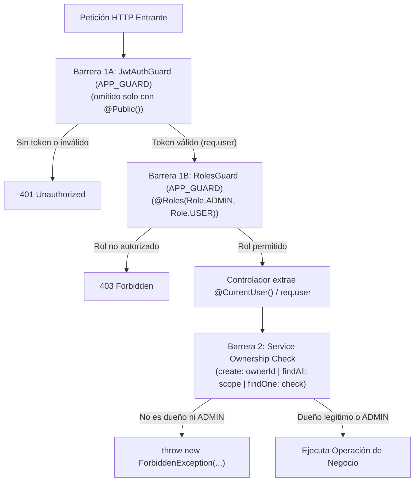

# Estrategia de RBAC y Validación de Ownership

Este documento establece la estrategia de seguridad de **doble barrera** en NestJS 12: guards globales (`JwtAuthGuard` → `RolesGuard`) en el perímetro HTTP y validación granular de propiedad (*ownership*) en los servicios.

---

## 1. La Doble Barrera de Seguridad



### Orden obligatorio de `APP_GUARD` en `AppModule`
`JwtAuthGuard` **DEBE** registrarse antes que `RolesGuard` para que `req.user` exista cuando `RolesGuard` evalúe el rol:

```typescript
// src/app.module.ts
@Module({
  providers: [
    { provide: APP_GUARD, useClass: JwtAuthGuard },
    { provide: APP_GUARD, useClass: RolesGuard },
  ],
})
export class AppModule {}
```

---

## 2. Piezas Compartidas en `src/common/`

No dupliques `enum Role` ni decoradores dentro de cada módulo:

- **`src/common/enums/role.enum.ts`**:
  ```typescript
  export enum Role {
    ADMIN = 'admin',
    STAFF = 'staff',
    USER = 'user',
  }
  ```
- **`src/common/decorators/public.decorator.ts`**: `SetMetadata(IS_PUBLIC_KEY, true)` para rutas abiertas (login, healthcheck).
- **`src/common/decorators/roles.decorator.ts`**: `SetMetadata(ROLES_KEY, roles)`.
- **`src/common/decorators/current-user.decorator.ts`**: `createParamDecorator` compatible con `NodeAdapter` y `ExpressAdapter` que extrae `req.user` tipado como `AuthUser`.

> **Prohibido:** usar fallbacks silenciosos como `req.user?.id || 'anonymous'`. Si un endpoint no tiene `@Public()`, `JwtAuthGuard` debe rechazar con `401` antes de llegar al controlador.

---

## 3. Ownership Completo en Servicios (`create`, `findAll`, `findOne`, `update`, `remove`)

```typescript
import { Inject, Injectable, NotFoundException, ForbiddenException } from '@nestjs/common';

import { Role } from '@/common/enums/role.enum';

import type { Invoice } from '../entities';
import { INVOICE_REPOSITORY_TOKEN, type IInvoiceRepository } from '../repositories';
import type { CreateInvoiceDto, UpdateInvoiceDto, FindInvoicesQueryDto } from '../dto';

@Injectable()
export class InvoiceService {
  constructor(
    @Inject(INVOICE_REPOSITORY_TOKEN)
    private readonly invoiceRepository: IInvoiceRepository,
  ) {}

  async create(dto: CreateInvoiceDto, requesterId: string, _requesterRole: string): Promise<Invoice> {
    // El ownerId siempre proviene del usuario autenticado, nunca del body
    return this.invoiceRepository.create({ ...dto, ownerId: requesterId });
  }

  async findAll(query: FindInvoicesQueryDto, requesterId: string, requesterRole: string) {
    const { page = 1, limit = 20, search } = query;
    const skip = (page - 1) * limit;
    // Usuarios comunes solo listan sus propios registros
    const ownerId = requesterRole === Role.ADMIN ? undefined : requesterId;

    const [items, total] = await this.invoiceRepository.findMany({ skip, take: limit, search, ownerId });
    return { items, total, page, limit };
  }

  async findOne(id: string, requesterId: string, requesterRole: string): Promise<Invoice> {
    const invoice = await this.invoiceRepository.findById(id);
    if (!invoice) {
      throw new NotFoundException('Factura no encontrada');
    }
    if (requesterRole !== Role.ADMIN && invoice.ownerId !== requesterId) {
      throw new ForbiddenException('No tienes permisos para acceder a esta factura');
    }
    return invoice;
  }
}
```

---

## 4. Respuestas y Excepciones HTTP Estándar

| Excepción | Código | Cuándo Lanzar |
| :--- | :---: | :--- |
| `BadRequestException` | `400` | Validación de DTO (`ValidationPipe`), UUID inválido (`ParseUUIDPipe`) o regla de negocio inválida. |
| `UnauthorizedException` | `401` | Token JWT ausente, expirado o inválido (`JwtAuthGuard`). |
| `ForbiddenException` | `403` | Rol insuficiente (`RolesGuard`) o fallo de *ownership* en servicio. |
| `NotFoundException` | `404` | El ID solicitado no existe en persistencia. |
| `ConflictException` | `409` | Violación de unicidad (email duplicado, código único ya registrado). |
