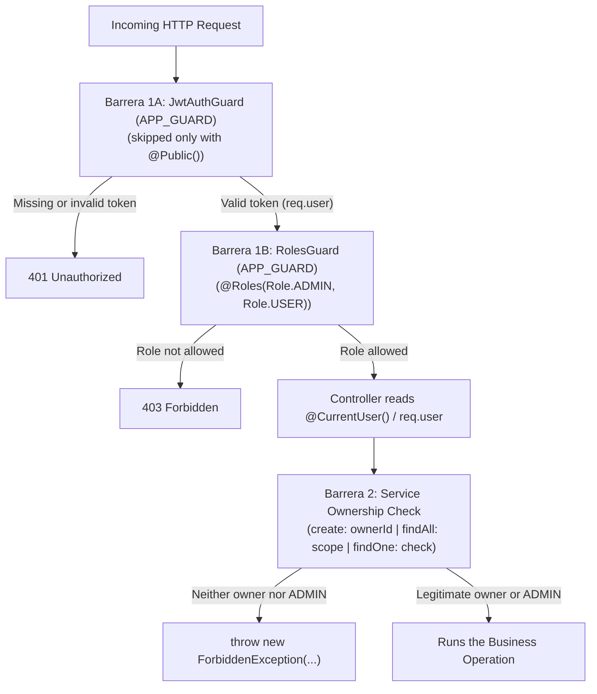

# RBAC and Ownership Validation Strategy

This document sets the **double barrier** security strategy in NestJS 12: global guards (`JwtAuthGuard` → `RolesGuard`) at the HTTP perimeter and fine-grained ownership validation in the services.

---

## 1. The Double Security Barrier



### Mandatory `APP_GUARD` order in `AppModule`
`JwtAuthGuard` **MUST** be registered before `RolesGuard` so `req.user` exists when `RolesGuard` evaluates the role:

```typescript
// src/app.module.ts
@Module({
  providers: [
    { provide: APP_GUARD, useClass: JwtAuthGuard },
    { provide: APP_GUARD, useClass: RolesGuard },
  ],
})
export class AppModule {}
```

---

## 2. Shared Pieces in `src/common/`

Do not duplicate `enum Role` or decorators inside each module:

- **`src/common/enums/role.enum.ts`**:
  ```typescript
  export enum Role {
    ADMIN = 'admin',
    STAFF = 'staff',
    USER = 'user',
  }
  ```
- **`src/common/decorators/public.decorator.ts`**: `SetMetadata(IS_PUBLIC_KEY, true)` for open routes (login, healthcheck).
- **`src/common/decorators/roles.decorator.ts`**: `SetMetadata(ROLES_KEY, roles)`.
- **`src/common/decorators/current-user.decorator.ts`**: a `createParamDecorator`, compatible with `NodeAdapter` and `ExpressAdapter`, that extracts `req.user` typed as `AuthUser`.

> **Forbidden:** silent fallbacks such as `req.user?.id || 'anonymous'`. If an endpoint has no `@Public()`, `JwtAuthGuard` must reject with `401` before the request reaches the controller.

---

## 3. Full Ownership in Services (`create`, `findAll`, `findOne`, `update`, `remove`)

```typescript
import { Inject, Injectable, NotFoundException, ForbiddenException } from '@nestjs/common';

import { Role } from '@/common/enums/role.enum';

import type { Invoice } from '../entities';
import { INVOICE_REPOSITORY_TOKEN, type IInvoiceRepository } from '../repositories';
import type { CreateInvoiceDto, UpdateInvoiceDto, FindInvoicesQueryDto } from '../dto';

@Injectable()
export class InvoiceService {
  constructor(
    @Inject(INVOICE_REPOSITORY_TOKEN)
    private readonly invoiceRepository: IInvoiceRepository,
  ) {}

  async create(dto: CreateInvoiceDto, requesterId: string, _requesterRole: string): Promise<Invoice> {
    // ownerId always comes from the authenticated user, never from the body
    return this.invoiceRepository.create({ ...dto, ownerId: requesterId });
  }

  async findAll(query: FindInvoicesQueryDto, requesterId: string, requesterRole: string) {
    const { page = 1, limit = 20, search } = query;
    const skip = (page - 1) * limit;
    // Regular users only list their own records
    const ownerId = requesterRole === Role.ADMIN ? undefined : requesterId;

    const [items, total] = await this.invoiceRepository.findMany({ skip, take: limit, search, ownerId });
    return { items, total, page, limit };
  }

  async findOne(id: string, requesterId: string, requesterRole: string): Promise<Invoice> {
    const invoice = await this.invoiceRepository.findById(id);
    if (!invoice) {
      throw new NotFoundException('Invoice not found');
    }
    if (requesterRole !== Role.ADMIN && invoice.ownerId !== requesterId) {
      throw new ForbiddenException('You do not have permission to access this invoice');
    }
    return invoice;
  }
}
```

---

## 4. Standard HTTP Responses and Exceptions

| Exception | Code | When to Throw |
| :--- | :---: | :--- |
| `BadRequestException` | `400` | DTO validation (`ValidationPipe`), an invalid UUID (`ParseUUIDPipe`) or a broken business rule. |
| `UnauthorizedException` | `401` | Missing, expired or invalid JWT (`JwtAuthGuard`). |
| `ForbiddenException` | `403` | Insufficient role (`RolesGuard`) or a failed *ownership* check in the service. |
| `NotFoundException` | `404` | The requested ID does not exist in persistence. |
| `ConflictException` | `409` | A uniqueness violation (duplicate email, unique code already registered). |
