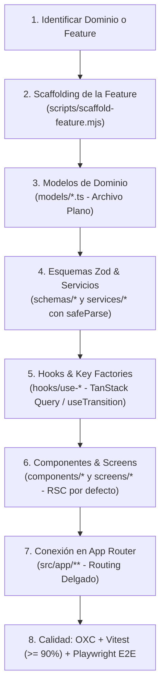

# ⚡ Next.js Screaming Architecture Standard

## 🎯 Propósito

Estandarizar el diseño, modularización y construcción de aplicaciones en **Next.js (App Router)** siguiendo los principios de **Screaming Architecture** (Feature-Driven / Domain-First). Garantiza código desacoplado, mantenible y predecible mediante encapsulación en subcarpetas, App Router delgado, separación estricta de responsabilidades (UI, hooks, servicios, esquemas y modelos), linting ultrarrápido con **OXC** y estrategia dual de pruebas con **Vitest + SWC** ($\ge 90\%$ unit/integration) y **Playwright** (E2E).

**Stack y Toolchain asumido:** Next.js App Router (SWC), React Server Components por defecto, TanStack Query, Zod, `shadcn/ui`, **OXC** (`oxlint` / `oxfmt`), **Vitest** (`@vitejs/plugin-react-swc` + `@testing-library/react` + `@vitest/coverage-v8`), **Playwright** (`@playwright/test`) y alias `@/*` → `src/*`.

---

## ⚡ Cuándo Activar esta Skill

- Al diseñar, crear o refactorizar módulos de negocio dentro de `src/features/<feature-name>/`.
- Al crear componentes UI compartidos (`src/components/common/`) o específicos de feature.
- Al conectar pantallas con rutas delgadas del App Router (`src/app/**`).
- Al implementar flujos de datos: **Server Actions** (`'use server'` con validación Zod en servidor) o **TanStack Query custom hooks**.
- Al construir modales de creación o edición siguiendo el estándar **FormDialog** (`*-form-dialog`).
- Al definir esquemas de validación Zod (`*.schema.ts`) o contratos de dominio (`models/*.ts`).
- Al configurar o ejecutar pruebas con **Vitest + SWC** ($\ge 90\%$), **Playwright E2E** (`e2e/`) y **OXC** (`oxlint`).
- Al validar convenciones de nombres, sufijos de archivo y prohibición de barrel files contenedores.

> **Monorepo:** si la web vive en un monorepo (`apps/web`), estas reglas aplican dentro de `apps/web/src/`. Para la estructura raíz, los paquetes compartidos, los contratos entre web y API y los límites de dependencias, usa también la skill [`monorepo-architecture`](../monorepo-architecture/SKILL.md). Genera las features con `--target-dir apps/web/src/features --app-dir apps/web/src/app`.

---

## 📋 Flujo de Trabajo Paso a Paso



### 1. Modelado de Dominio (`models/`)
Definir las interfaces, tipos y enums del dominio en archivos planos dentro de `src/features/<feature>/models/<entity>.ts` (o `src/models/` para modelos globales compartidos).
- **Regla**: Son archivos planos de TypeScript puro. Al contener archivos directamente sin subcarpetas, `models/` incluye su propio `index.ts` para reexportar sus contratos. Sin archivos `.test.ts`.

### 2. Esquemas de Validación (`schemas/`)
Definir validaciones de formularios y contratos en tiempo de ejecución con **Zod**:
- **Archivos planos**: Se definen directamente dentro de `schemas/<name>.schema.ts` (ej. `create-invoice.schema.ts`).
- **Sin pruebas unitarias**: Al igual que `models/`, son declaraciones de esquemas puras y no llevan archivos `.test.ts`.
- **Barrel local**: Al ser una carpeta hoja con archivos directos, `schemas/index.ts` reexporta todos los esquemas de la feature.
- **Identificador**: Constante en `camelCase` terminada en `Schema` (ej. `createInvoiceSchema`).

### 3. Servicios de Datos (`services/`)
Implementar toda comunicación con APIs externas o base de datos (los componentes y hooks nunca llaman a `fetch` directamente):
- Encapsular cada servicio en su propia subcarpeta: `<verb>-<noun>/<verb>-<noun>.service.ts` con su `.service.test.ts` e `index.ts`.
- Declarar `'use server'` cuando actúe como Server Action de Next.js y **validar obligatoriamente la entrada en el servidor** con `schema.safeParse(input)` antes de tocar API/DB, invocando `revalidatePath` / `revalidateTag` cuando corresponda.
- Usar `fetch` nativo con políticas de caché explícitas (`cache: 'no-store'` o `next: { revalidate }`).

### 4. Orquestación de Estado y Consultas (`hooks/`)
Aislar la lógica de estado fuera de los componentes de UI:
- Subcarpeta: `hooks/use-<action>/use-<action>.hook.ts` (un hook por subcarpeta, con `.hook.test.ts` e `index.ts`).
- Para mutaciones con Server Actions: usar `useTransition` o `useActionState` invocando al servicio de `services/`.
- Para fetching y caché reactivo en cliente: usar **TanStack Query** (`useQuery` / `useMutation`) delegando el I/O a `services/`. La *Query Key Factory* (`<noun>Keys`) se exporta desde el hook principal de consulta (`hooks/use-<nouns>`) y nunca como archivo suelto en `hooks/`.

### 5. Componentes y Pantallas (`components/`, `screens/`)
Construir los bloques de interfaz visual:
- **Server Components por defecto**: Las `screens/` y `components/` son RSC por defecto; añadir `'use client'` únicamente en las hojas interactivas (`*-form-dialog`, controles con hooks o eventos).
- Seguir el protocolo de 3 niveles: (1) Reutilizar de `src/components/`, (2) Añadir desde `shadcn/ui`, (3) Crear componente custom con `scaffold-component.mjs`.
- Encapsular en subcarpeta con: implementación, test unitario en **Vitest** adyacente y local barrel `index.ts`.
- Para modales de formularios: extender el estándar `FormDialog` en subcarpetas `*-form-dialog/` (`--type dialog`). Para bloques de página con encabezado semántico: usar `--type section` (`<section>` + `<h2>`).
- Documentar todas las interfaces de props y componentes con **TSDoc**.

### 6. Integración en App Router (`src/app/`)
- Las páginas (`page.tsx`) y layouts (`layout.tsx`) deben ser ultra delgadas: importar y renderizar la screen correspondiente (`import { FeatureHome } from '@/features/<feature>/screens/<feature>-home'`), exportar `Metadata` y armar la composición visual. En Next.js 15+, `params` y `searchParams` se tipan como `Promise<...>`.
- **Cero Pruebas Unitarias en `src/app/`**: No se colocan archivos `.test.tsx` dentro de `src/app/`. Si un layout o página requiere lógica (transformación de parámetros, verificación de acceso o ensamblado dinámico de metadatos), esta se extrae obligatoriamente a `src/features/<feature-name>/utils/` (reexportada en `utils/index.ts`) con sus pruebas en Vitest. Las rutas de `src/app/` se verifican E2E con **Playwright** en `e2e/`.

---

## ⚠️ Reglas Críticas

1. **Regla de la Hoja Terminal para Barrels (*Leaf-Folder Barrel Policy*)**:
   - Una carpeta **SOLO** debe tener `index.ts` si contiene **directamente archivos de implementación** (carpeta hoja).
   - Si una carpeta agrupa **subcarpetas** (como la raíz de la feature `src/features/<feature>/`, agrupadores como `components/`, `hooks/`, `screens/`, `services/`, `sections/`), **NUNCA** lleva `index.ts` ni archivos sueltos.
   - Únicamente las subcarpetas finales (`components/invoice-card/`, `hooks/use-invoices/`, `services/create-invoice/`) o carpetas con archivos directos (`models/`, `schemas/`, `utils/`) tienen `index.ts`.
2. **Importaciones Directas con Alias `@/*` a la Carpeta con `index.ts`**:
   - Importar siempre con alias `@/*` apuntando a la carpeta hoja que posee el `index.ts` (y ordenar imports tras formatear con [`ts-import-organizer`](../../tooling/ts-import-organizer/SKILL.md)):
     ```typescript
     // ✅ CORRECTO: Importación desde la carpeta hoja que posee index.ts
     import { InvoiceCard } from '@/features/pets/components/invoice-card';
     import { usePetSearch } from '@/features/pets/hooks/use-pet-search';
     import { IPet } from '@/features/pets/models';
     import { createPetSchema } from '@/features/pets/schemas';
     import { parsePetFilters } from '@/features/pets/utils';

     // ❌ PROHIBIDO: Importar desde carpetas contenedoras padre o saltar el barrel de utils/models/schemas
     import { usePetSearch, IPet } from '@/features/pets';
     import { InvoiceCard } from '@/features/pets/components';
     import { parsePetFilters } from '@/features/pets/utils/parse-pet-filters';
     ```
3. **Encapsulación por Subcarpeta**:
   - Todo componente, screen, hook, servicio o contexto debe tener su subcarpeta en `kebab-case` con su implementación, test unitario en Vitest e `index.ts` local.
4. **Toolchain y Cobertura Dual (Vitest + SWC $\ge 90\%$ & Playwright E2E)**:
   - **Vitest + SWC**: Todo componente, screen, hook, servicio o función en `utils/` debe contar con su `.test.tsx` o `.test.ts` adyacente usando imports explícitos de `'vitest'` (`describe`, `it`, `expect`, `vi.fn()`). Prohibido usar globales de Jest (`jest.fn()`).
   - **Exclusiones Explícitas de Pruebas Unitarias**: `models/`, `schemas/`, `src/config/`, `src/app/` y todos los `index.ts`.
   - **Playwright E2E**: Los flujos de rutas en `src/app/**` y diálogos modales críticos se prueban en `e2e/<feature>.spec.ts`.
   - **OXC (`oxlint`)**: Validar ausencia de ciclos (`import/no-cycle`), reglas de hooks y tipado estricto sin `any`.

---

## 📚 Referencias

- [Guía Detallada de Screaming Architecture](references/screaming-architecture-guide.md): Estructura exhaustiva de directorios, frontera RSC vs Client, capas, sufijos y convenciones de nombres.
- [Patrones de Componentes y FormDialog](references/component-and-dialog-patterns.md): Protocolo de descubrimiento en 3 niveles, contenedor `FormDialog` conectado con Zod y TSDoc.
- [Patrones de Datos: Server Actions & TanStack Query](references/tanstack-and-actions-pattern.md): Validación Zod en servidor, servicios dedicados y key factories en hooks hoja.
- [Testing y Toolchain: Vitest, Playwright, OXC y SWC](references/testing-and-toolchain.md): Configuración de `vitest.config.ts` con SWC y cobertura $\ge 90\%$, Playwright E2E y `.oxlintrc.json`.

---

## 🛠️ Scripts

> **Rutas:** `<skill-dir>` es el directorio que contiene este `SKILL.md` (p. ej. `.claude/skills/<name>/` o `.agents/skills/<name>/`). Ejecuta los scripts desde la raíz del proyecto del usuario, no desde `<skill-dir>`.

> **Seguridad:** los scripts abortan sin escribir nada si alguno de los archivos que generan ya existe. Ejecuta primero con `--dry-run` para ver qué se va a crear. Usa `--force` (sobrescribe esos archivos) solo con confirmación explícita del usuario.

La skill incluye scripts de Node.js ESM (sin dependencias externas) para acelerar el andamiaje del proyecto:

### 1. Generar una Feature Completa
```bash
node <skill-dir>/scripts/scaffold-feature.mjs <feature-name> [--target-dir <path>] [--app-dir <path>] [--with-starter] [--with-route] [--dry-run] [--force]
```
*Ejemplo:* `node <skill-dir>/scripts/scaffold-feature.mjs billing --with-starter --with-route`

Crea las 7 subcarpetas de la feature (`components`, `hooks`, `models`, `schemas`, `screens`, `services`, `utils`). `--with-starter` genera además un modelo plano inicial (`models/<feature>.ts` + barrel) y una screen encapsulada (`screens/<feature>-home/`) con su test en Vitest. `--with-route` (requiere `--with-starter`) añade la ruta delgada `src/app/<feature>/page.tsx` con `Metadata` y renderizado de la screen.

### 2. Generar un Componente Encapsulado
```bash
node <skill-dir>/scripts/scaffold-component.mjs <component-name> [--target-dir <path>] [--type default|dialog|section] [--dry-run] [--force]
```
*Ejemplo:* `node <skill-dir>/scripts/scaffold-component.mjs invoice-form-dialog --target-dir src/features/billing/components --type dialog`

Genera la subcarpeta `<component-name>/` con el componente (`default`, modal `'use client'` con `FormDialog` para `dialog`, o `<section>` semántico con `<h2>` para `section`), su test unitario en Vitest (`vi.fn()`) y su `index.ts`.
