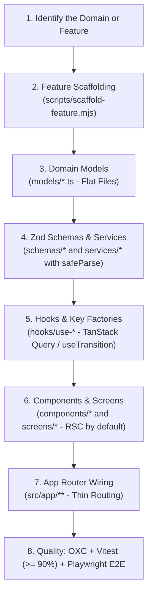

# ⚡ Next.js Screaming Architecture Standard

## 🎯 Purpose

Standardize the design, modularization and build of **Next.js (App Router)** applications following the principles of **Screaming Architecture** (Feature-Driven / Domain-First). It keeps code decoupled, maintainable and predictable through subfolder encapsulation, a thin App Router, strict separation of concerns (UI, hooks, services, schemas and models), ultra-fast linting with **OXC** and a dual test strategy with **Vitest + SWC** ($\ge 90\%$ unit/integration) and **Playwright** (E2E).

**Assumed stack and toolchain:** Next.js App Router (SWC), React Server Components by default, TanStack Query, Zod, `shadcn/ui`, **OXC** (`oxlint` / `oxfmt`), **Vitest** (`@vitejs/plugin-react-swc` + `@testing-library/react` + `@vitest/coverage-v8`), **Playwright** (`@playwright/test`) and the `@/*` → `src/*` alias.

---

## ⚡ When to Trigger This Skill

- When designing, creating or refactoring business modules inside `src/features/<feature-name>/`.
- When creating shared UI components (`src/components/common/`) or feature-specific ones.
- When wiring screens to thin App Router routes (`src/app/**`).
- When implementing data flows: **Server Actions** (`'use server'` with server-side Zod validation) or **custom TanStack Query hooks**.
- When building create or edit modals following the **FormDialog** standard (`*-form-dialog`).
- When defining Zod validation schemas (`*.schema.ts`) or domain contracts (`models/*.ts`).
- When configuring or running tests with **Vitest + SWC** ($\ge 90\%$), **Playwright E2E** (`e2e/`) and **OXC** (`oxlint`).
- When checking naming conventions, file suffixes and the ban on container barrel files.

> **Monorepo:** if the web app lives in a monorepo (`apps/web`), these rules apply inside `apps/web/src/`. For the root structure, shared packages, web/API contracts and dependency boundaries, also use the [`monorepo-architecture`](../monorepo-architecture/SKILL.md) skill. Generate features with `--target-dir apps/web/src/features --app-dir apps/web/src/app`.

---

## 📋 Step-by-Step Workflow



### 1. Domain Modeling (`models/`)
Define the domain's interfaces, types and enums in flat files inside `src/features/<feature>/models/<entity>.ts` (or `src/models/` for shared global models).
- **Rule**: they are flat, pure TypeScript files. Since it holds files directly with no subfolders, `models/` has its own `index.ts` to re-export its contracts. No `.test.ts` files.

### 2. Validation Schemas (`schemas/`)
Define form validations and runtime contracts with **Zod**:
- **Flat files**: defined directly in `schemas/<name>.schema.ts` (e.g. `create-invoice.schema.ts`).
- **No unit tests**: like `models/`, they are pure schema declarations and have no `.test.ts` files.
- **Local barrel**: as a leaf folder with direct files, `schemas/index.ts` re-exports all the feature's schemas.
- **Identifier**: a `camelCase` constant ending in `Schema` (e.g. `createInvoiceSchema`).

### 3. Data Services (`services/`)
Implement all communication with external APIs or the database (components and hooks never call `fetch` directly):
- Wrap each service in its own subfolder: `<verb>-<noun>/<verb>-<noun>.service.ts` with its `.service.test.ts` and `index.ts`.
- Declare `'use server'` when it acts as a Next.js Server Action, and **always validate the input on the server** with `schema.safeParse(input)` before touching the API/DB, calling `revalidatePath` / `revalidateTag` when needed.
- Use native `fetch` with explicit cache policies (`cache: 'no-store'` or `next: { revalidate }`).

### 4. State and Query Orchestration (`hooks/`)
Keep state logic out of UI components:
- Subfolder: `hooks/use-<action>/use-<action>.hook.ts` (one hook per subfolder, with `.hook.test.ts` and `index.ts`).
- For mutations with Server Actions: use `useTransition` or `useActionState`, calling the service from `services/`.
- For client-side fetching and reactive caching: use **TanStack Query** (`useQuery` / `useMutation`), delegating I/O to `services/`. The *Query Key Factory* (`<noun>Keys`) is exported from the main query hook (`hooks/use-<nouns>`), never as a loose file in `hooks/`.

### 5. Components and Screens (`components/`, `screens/`)
Build the visual interface blocks:
- **Server Components by default**: `screens/` and `components/` are RSC by default; add `'use client'` only to interactive leaves (`*-form-dialog`, controls with hooks or events).
- Follow the 3-level protocol: (1) reuse from `src/components/`, (2) add from `shadcn/ui`, (3) create a custom component with `scaffold-component.mjs`.
- Encapsulate in a subfolder with the implementation, an adjacent **Vitest** unit test and a local `index.ts` barrel.
- For form modals: extend the `FormDialog` standard in `*-form-dialog/` subfolders (`--type dialog`). For page blocks with a semantic heading: use `--type section` (`<section>` + `<h2>`).
- Document every props interface and component with **TSDoc**.

### 6. App Router Integration (`src/app/`)
- Pages (`page.tsx`) and layouts (`layout.tsx`) must be ultra-thin: import and render the matching screen (`import { FeatureHome } from '@/features/<feature>/screens/<feature>-home'`), export `Metadata` and assemble the visual composition. In Next.js 15+, `params` and `searchParams` are typed as `Promise<...>`.
- **Zero Unit Tests in `src/app/`**: no `.test.tsx` files go inside `src/app/`. If a layout or page needs logic (parameter transformation, access checks or dynamic metadata assembly), it must be extracted to `src/features/<feature-name>/utils/` (re-exported in `utils/index.ts`) with its Vitest tests. The `src/app/` routes are verified E2E with **Playwright** in `e2e/`.

---

## ⚠️ Critical Rules

1. **Reply in the user's language**, even though this skill is written in English.
2. **Leaf-Folder Barrel Policy**:
   - A folder has an `index.ts` **ONLY** if it **directly contains implementation files** (a leaf folder).
   - If a folder groups **subfolders** (such as the feature root `src/features/<feature>/`, or groupers like `components/`, `hooks/`, `screens/`, `services/`, `sections/`), it **NEVER** has an `index.ts` or loose files.
   - Only the final subfolders (`components/invoice-card/`, `hooks/use-invoices/`, `services/create-invoice/`) or folders with direct files (`models/`, `schemas/`, `utils/`) have an `index.ts`.
3. **Direct `@/*` Imports to the Folder That Has the `index.ts`**:
   - Always import with the `@/*` alias pointing to the leaf folder that owns the `index.ts` (and sort imports after formatting with [`ts-import-organizer`](../../tooling/ts-import-organizer/SKILL.md)):
     ```typescript
     // ✅ CORRECT: import from the leaf folder that owns index.ts
     import { InvoiceCard } from '@/features/pets/components/invoice-card';
     import { usePetSearch } from '@/features/pets/hooks/use-pet-search';
     import { IPet } from '@/features/pets/models';
     import { createPetSchema } from '@/features/pets/schemas';
     import { parsePetFilters } from '@/features/pets/utils';

     // ❌ FORBIDDEN: importing from parent container folders or skipping the utils/models/schemas barrel
     import { usePetSearch, IPet } from '@/features/pets';
     import { InvoiceCard } from '@/features/pets/components';
     import { parsePetFilters } from '@/features/pets/utils/parse-pet-filters';
     ```
4. **Subfolder Encapsulation**:
   - Every component, screen, hook, service or context must have its own `kebab-case` subfolder with its implementation, a Vitest unit test and a local `index.ts`.
5. **Toolchain and Dual Coverage (Vitest + SWC $\ge 90\%$ & Playwright E2E)**:
   - **Vitest + SWC**: every component, screen, hook, service or function in `utils/` must have an adjacent `.test.tsx` or `.test.ts` using explicit imports from `'vitest'` (`describe`, `it`, `expect`, `vi.fn()`). Jest globals (`jest.fn()`) are forbidden.
   - **Explicit Unit Test Exclusions**: `models/`, `schemas/`, `src/config/`, `src/app/` and every `index.ts`.
   - **Playwright E2E**: route flows in `src/app/**` and critical modal dialogs are tested in `e2e/<feature>.spec.ts`.
   - **OXC (`oxlint`)**: check for no cycles (`import/no-cycle`), hook rules and strict typing without `any`.

---

## 📚 References

- [Detailed Screaming Architecture Guide](references/screaming-architecture-guide.md): the full directory structure, the RSC vs Client boundary, layers, suffixes and naming conventions.
- [Component and FormDialog Patterns](references/component-and-dialog-patterns.md): the 3-level discovery protocol, the `FormDialog` container wired to Zod, and TSDoc.
- [Data Patterns: Server Actions & TanStack Query](references/tanstack-and-actions-pattern.md): server-side Zod validation, dedicated services and key factories in leaf hooks.
- [Testing and Toolchain: Vitest, Playwright, OXC and SWC](references/testing-and-toolchain.md): `vitest.config.ts` setup with SWC and $\ge 90\%$ coverage, Playwright E2E and `.oxlintrc.json`.

---

## 🛠️ Scripts

> **Paths:** `<skill-dir>` is the directory that holds this `SKILL.md` (e.g. `.claude/skills/<name>/` or `.agents/skills/<name>/`). Run the scripts from the user's project root, not from `<skill-dir>`.

> **Safety:** the scripts abort without writing anything if any of the files they generate already exists. Run them with `--dry-run` first to see what will be created. Use `--force` (which overwrites those files) only with the user's explicit confirmation.

The skill includes Node.js ESM scripts (no external dependencies) to speed up project scaffolding:

### 1. Generate a Full Feature
```bash
node <skill-dir>/scripts/scaffold-feature.mjs <feature-name> [--target-dir <path>] [--app-dir <path>] [--with-starter] [--with-route] [--dry-run] [--force]
```
*Example:* `node <skill-dir>/scripts/scaffold-feature.mjs billing --with-starter --with-route`

Creates the feature's 7 subfolders (`components`, `hooks`, `models`, `schemas`, `screens`, `services`, `utils`). `--with-starter` also generates an initial flat model (`models/<feature>.ts` + barrel) and an encapsulated screen (`screens/<feature>-home/`) with its Vitest test. `--with-route` (requires `--with-starter`) adds the thin route `src/app/<feature>/page.tsx` with `Metadata` that renders the screen.

### 2. Generate an Encapsulated Component
```bash
node <skill-dir>/scripts/scaffold-component.mjs <component-name> [--target-dir <path>] [--type default|dialog|section] [--dry-run] [--force]
```
*Example:* `node <skill-dir>/scripts/scaffold-component.mjs invoice-form-dialog --target-dir src/features/billing/components --type dialog`

Generates the `<component-name>/` subfolder with the component (`default`; a `'use client'` modal with `FormDialog` for `dialog`; or a semantic `<section>` with an `<h2>` for `section`), its Vitest unit test (`vi.fn()`) and its `index.ts`.
