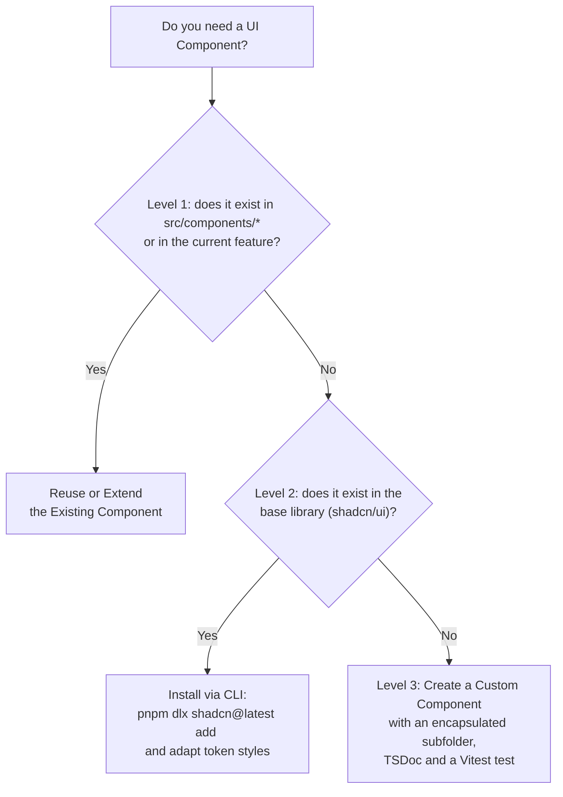

# Component Patterns, FormDialog and TSDoc Documentation

This document defines the lifecycle, discovery, modularization and documentation of UI components in Next.js.

---

## 1. Component Discovery Protocol (3-Tier Sequence)

Before creating any visual component (shared or feature-specific), the developer or agent must strictly follow this 3-level validation sequence:



1. **Level 1 — Check existing components**:
   - Review `src/components/ui/` (base primitives), `src/components/common/` (reusable composites) or the components inside the current feature (`src/features/<feature>/components/`).
   - If it exists, reuse it or parameterize it with optional props.
2. **Level 2 — Install from the base registry (`shadcn/ui`)**:
   - If it does not exist in the project, check whether it is available in `shadcn/ui` (e.g. `dialog`, `badge`, `table`, `sheet`, `popover`).
   - Install it with `pnpm dlx shadcn@latest add <component>` and adapt the variants and color tokens to the app's design.
3. **Level 3 — Build a Custom Component**:
   - Only if it exists neither locally nor in the base registry, generate a new component following the subfolder standard (`<name>/<name>.tsx`, `<name>/<name>.test.tsx`, `<name>/index.ts`), with documented interfaces and semantic styles.

---

## 2. Modal Dialog Architecture: the `FormDialog` Standard

Every modal form for creating, editing, confirming or submitting entities must follow the **FormDialog** pattern.

### 2.1 Reusable Base Container (`src/components/common/form-dialog/form-dialog.tsx`)
The `FormDialog` container wraps the `shadcn/ui` `Dialog` primitive:

```tsx
'use client';

import React from 'react';
import {
  Dialog,
  DialogContent,
  DialogDescription,
  DialogHeader,
  DialogTitle,
  DialogTrigger,
} from '@/components/ui/dialog';

/**
 * Props for {@link FormDialog}.
 */
export interface IFormDialogProps {
  /** Main title of the modal header. */
  readonly title: string;
  /** Optional subtitle or instructions for the modal. */
  readonly description?: string;
  /** Optional decorative icon in the header. */
  readonly icon?: React.ReactNode;
  /** Open state in controlled mode. */
  readonly open?: boolean;
  /** Callback when the open state changes. */
  readonly onOpenChange?: (open: boolean) => void;
  /** Optional trigger element; pass null when the parent controls it. */
  readonly trigger?: React.ReactNode | null;
  /** Form content inside the modal. */
  readonly children: React.ReactNode;
}

/**
 * Standardized modal container for create and edit forms.
 */
export function FormDialog({
  title,
  description,
  icon,
  open,
  onOpenChange,
  trigger,
  children,
}: Readonly<IFormDialogProps>): React.JSX.Element {
  return (
    <Dialog open={open} onOpenChange={onOpenChange}>
      {trigger ? <DialogTrigger asChild>{trigger}</DialogTrigger> : null}
      <DialogContent className="max-h-[90vh] overflow-y-auto sm:max-w-lg">
        <DialogHeader>
          <DialogTitle className="flex items-center gap-2">
            {icon}
            <span>{title}</span>
          </DialogTitle>
          {description ? <DialogDescription>{description}</DialogDescription> : null}
        </DialogHeader>
        {children}
      </DialogContent>
    </Dialog>
  );
}
```

### 2.2 The `*-form-dialog` Entity Subfolder
Each entity modal form lives in its own dedicated subfolder ending in `-form-dialog` inside the feature:

```text
src/features/billing/components/invoice-form-dialog/
├── index.ts
├── invoice-form-dialog.test.tsx
└── invoice-form-dialog.tsx
```

### 2.3 Full Wiring: `FormDialog` + Zod Schema + Hook
1. **Props Interface (`I<Entity>FormDialogProps`)**:
   ```tsx
   'use client';

   import React, { useState } from 'react';
   import { FormDialog } from '@/components/common/form-dialog';
   import { useCreateInvoice } from '@/features/billing/hooks/use-create-invoice';
   import type { IInvoice } from '@/features/billing/models';
   import { createInvoiceSchema } from '@/features/billing/schemas';

   export interface IInvoiceFormDialogProps {
     /** Controls the modal's visibility in controlled mode. */
     readonly open?: boolean;
     /** Callback run when the open state changes. */
     readonly onOpenChange?: (open: boolean) => void;
     /** Optional trigger; null when opened from a table or parent state. */
     readonly trigger?: React.ReactNode | null;
     /** Optional entity for edit mode. If null/undefined, it works in create mode. */
     readonly initialData?: IInvoice | null;
     /** Callback when the operation completes successfully. */
     readonly onSuccess?: () => void;
   }

   export function InvoiceFormDialog({
     open,
     onOpenChange,
     trigger,
     initialData,
     onSuccess,
   }: Readonly<IInvoiceFormDialogProps>): React.JSX.Element {
     const { execute, isPending } = useCreateInvoice();
     const [error, setError] = useState<string | null>(null);

     const handleSubmit = (event: React.FormEvent<HTMLFormElement>) => {
       event.preventDefault();
       const formData = new FormData(event.currentTarget);
       const parsed = createInvoiceSchema.safeParse({
         customerId: formData.get('customerId'),
         amount: formData.get('amount'),
         currency: formData.get('currency') ?? 'USD',
       });

       if (!parsed.success) {
         setError(parsed.error.issues[0]?.message ?? 'Invalid data');
         return;
       }

       setError(null);
       execute(parsed.data, () => {
         onOpenChange?.(false);
         onSuccess?.();
       });
     };

     return (
       <FormDialog
         title={initialData ? 'Edit Invoice' : 'New Invoice'}
         description="Fill in the invoice's billing details."
         open={open}
         onOpenChange={onOpenChange}
         trigger={trigger}
       >
         <form onSubmit={handleSubmit} className="space-y-4 py-2">
           {error ? <p role="alert" className="text-sm text-destructive">{error}</p> : null}
           {/* Form fields or a presentational subcomponent */}
           <div className="flex justify-end gap-2 pt-4">
             <button type="button" onClick={() => onOpenChange?.(false)} className="px-4 py-2 text-sm border rounded-md">
               Cancel
             </button>
             <button type="submit" disabled={isPending} className="px-4 py-2 text-sm bg-primary text-primary-foreground rounded-md">
               Save
             </button>
           </div>
         </form>
       </FormDialog>
     );
   }
   ```
2. **Presentational Subforms**: if the form is long or has several steps, the dialog delegates the fields to a pure presentational component (`invoice-form.tsx`), keeping the dialog focused on the modal's lifecycle.

---

## 3. TSDoc Documentation Standard

Every component exported from `src/components/common/` and `src/features/**/components/` (including screens and sections) must include thorough **TSDoc** blocks.

### Documentation Template:

```tsx
import React from 'react';

/**
 * Props for {@link MetricCard}.
 */
export interface IMetricCardProps {
  /** Main title of the metric card. */
  readonly title: string;
  /** Numeric value or text representing the metric. */
  readonly value: string | number;
  /** Percentage change from the previous period. */
  readonly trendPercentage?: number;
  /** Representative visual icon. */
  readonly icon?: React.ReactNode;
  /** Optional callback when interacting with the card. */
  readonly onClick?: () => void;
}

/**
 * Renders a metric summary card with a trend indicator and an icon.
 *
 * @param props - Configuration options described in {@link IMetricCardProps}.
 * @returns The rendered JSX element.
 *
 * @example
 * ```tsx
 * import { MetricCard } from '@/components/common/metric-card';
 *
 * export function Example() {
 *   return (
 *     <MetricCard
 *       title="Monthly Revenue"
 *       value="$12,450"
 *       trendPercentage={8.4}
 *     />
 *   );
 * }
 * ```
 */
export function MetricCard({
  title,
  value,
  trendPercentage,
  icon,
  onClick,
}: Readonly<IMetricCardProps>): React.JSX.Element {
  return (
    <div
      role="button"
      tabIndex={onClick ? 0 : undefined}
      onClick={onClick}
      className="p-4 rounded-xl border bg-card text-card-foreground shadow-sm"
    >
      <div className="flex items-center justify-between">
        <span className="text-sm font-medium text-muted-foreground">{title}</span>
        {icon && <div className="text-muted-foreground">{icon}</div>}
      </div>
      <div className="mt-2 text-2xl font-bold">{value}</div>
      {trendPercentage !== undefined && (
        <p className="mt-1 text-xs text-muted-foreground">
          {trendPercentage >= 0 ? `+${trendPercentage}%` : `${trendPercentage}%`} vs last month
        </p>
      )}
    </div>
  );
}
```
