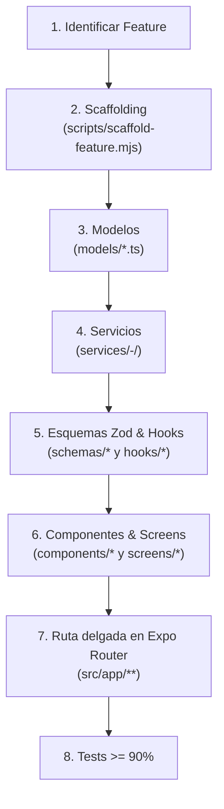

# 📱 React Native Screaming Architecture Standard

## 🎯 Propósito

Estandarizar el diseño y la modularización de apps **React Native con Expo Router** siguiendo **Screaming Architecture** (Feature-Driven / Domain-First), el equivalente móvil de [`nextjs-architecture`](../nextjs-architecture/SKILL.md). Garantiza código desacoplado mediante encapsulación en subcarpetas, rutas delgadas en `src/app`, separación de UI, hooks, servicios, esquemas y modelos, y tests con cobertura $\ge 90\%$.

**Stack asumido:** Expo + Expo Router, TanStack Query, NativeWind (`className`), Zod, Jest + `@testing-library/react-native`, alias `@/*` → `src/*`.

---

## ⚡ Cuándo Activar esta Skill

- Al crear o refactorizar módulos de negocio en `src/features/<feature-name>/`.
- Al crear componentes compartidos (`src/components/common/`) o específicos de una feature.
- Al conectar pantallas con rutas de Expo Router (`src/app/**`).
- Al implementar flujos de datos con **TanStack Query** (hooks + servicios).
- Al definir esquemas Zod (`*.schema.ts`) o modelos de dominio (`models/*.ts`).
- Al validar nombres, sufijos y la política de barrel files.

> **Monorepo:** si la app vive en `apps/mobile`, aplica estas reglas dentro de `apps/mobile/src/` y usa también [`monorepo-architecture`](../monorepo-architecture/SKILL.md). Genera con `--target-dir apps/mobile/src/features --app-dir apps/mobile/src/app`.

---

## 📋 Flujo de Trabajo Paso a Paso



### 1. Modelado de dominio (`models/`)
Archivos planos TypeScript en `models/<entity>.ts`, con `models/index.ts` que los reexporta. Sin tests.

### 2. Servicios (`services/`)
Un servicio por subcarpeta: `<verb>-<noun>/<verb>-<noun>.service.ts` con su test e `index.ts`. Usan `fetch` o el cliente HTTP de `src/config/`; no hay Server Actions en móvil.

### 3. Esquemas (`schemas/`)
Archivos planos `<name>.schema.ts` con Zod, constante `camelCase` terminada en `Schema`, barrel `schemas/index.ts`. Sin tests.

### 4. Hooks (`hooks/`)
`hooks/use-<action>/use-<action>.hook.ts` con **TanStack Query** (`useQuery` / `useMutation`) y key factories dedicadas. Ver [patrón TanStack Query](references/tanstack-query-pattern.md).

### 5. Componentes y screens (`components/`, `screens/`)
- Usar primitivas de RN (`View`, `Text`, `Pressable`) con `className` de NativeWind; sin `div`/`span`.
- Cada componente o screen vive en su subcarpeta con implementación, test adyacente e `index.ts`.
- Modales: arquetipo `--type modal`. Documentar props con TSDoc. Ver [patrones de componentes](references/nativewind-component-patterns.md).

### 6. Rutas en Expo Router (`src/app/`)
Cada `index.tsx`, `[id].tsx` o `_layout.tsx` solo importa y reexporta/renderiza la screen de la feature. Sin lógica ni tests en `src/app/`; si hace falta lógica (parámetros, guardas de acceso), se extrae a `src/features/<feature>/utils/`. Ver [rutas delgadas](references/expo-router-thin-routes.md).

---

## ⚠️ Reglas Críticas

1. **Barrels solo en carpetas hoja (*Leaf-Folder Barrel Policy*)**: `index.ts` únicamente en carpetas con archivos de implementación directos (`components/invoice-card/`, `models/`, `schemas/`, `utils/`). Nunca en la raíz de la feature ni en agrupadores como `components/`, `hooks/`, `screens/`.
2. **Imports directos a la carpeta con `index.ts`**:
   ```typescript
   // ✅ CORRECTO
   import { usePetSearch } from '@/features/pets/hooks/use-pet-search';
   import { IPet } from '@/features/pets/models';

   // ❌ PROHIBIDO: carpetas contenedoras
   import { usePetSearch, IPet } from '@/features/pets';
   import { InvoiceCard } from '@/features/pets/components';
   ```
3. **Encapsulación por subcarpeta** en `kebab-case`: implementación, test e `index.ts`.
4. **Rutas delgadas**: `src/app/**` no contiene lógica ni tests.
5. **Cobertura $\ge 90\%$** con tests adyacentes (`.test.ts(x)`). Excluidos: `models/`, `schemas/`, `src/config/`, `src/app/` y los `index.ts`.
6. **Sin web APIs**: nada de `div`, `window` ni `localStorage`; usar RN y `expo-secure-store` / `AsyncStorage`.

---

## 📚 Referencias

- [Guía de Screaming Architecture](references/screaming-architecture-guide.md): estructura de directorios, capas y convenciones de nombres.
- [Rutas delgadas con Expo Router](references/expo-router-thin-routes.md): cómo conectar screens a `src/app`.
- [Patrón TanStack Query](references/tanstack-query-pattern.md): servicios, key factories, queries y mutaciones.
- [Patrones de componentes con NativeWind](references/nativewind-component-patterns.md): primitivas, modales y testing.

---

## 🛠️ Scripts

> **Rutas:** `<skill-dir>` es el directorio que contiene este `SKILL.md` (p. ej. `.claude/skills/<name>/` o `.agents/skills/<name>/`). Ejecuta los scripts desde la raíz del proyecto del usuario, no desde `<skill-dir>`.

> **Seguridad:** los scripts abortan sin escribir nada si alguno de los archivos que generan ya existe. Ejecuta primero con `--dry-run` para ver qué se va a crear. Usa `--force` (sobrescribe esos archivos) solo con confirmación explícita del usuario.

### 1. Generar una feature completa
```bash
node <skill-dir>/scripts/scaffold-feature.mjs <feature-name> [--target-dir <path>] [--app-dir <path>] [--with-starter] [--with-route] [--dry-run] [--force]
```
*Ejemplo:* `node <skill-dir>/scripts/scaffold-feature.mjs billing --with-starter --with-route`

Crea las 7 carpetas de la feature. `--with-starter` añade `models/<feature>.ts` (+ barrel) y la screen `screens/<feature>-home/` con su test. `--with-route` (requiere `--with-starter`) añade `src/app/<feature>/index.tsx` que solo reexporta la screen.

### 2. Generar un componente encapsulado
```bash
node <skill-dir>/scripts/scaffold-component.mjs <component-name> [--target-dir <path>] [--type default|modal|section] [--dry-run] [--force]
```
*Ejemplo:* `node <skill-dir>/scripts/scaffold-component.mjs create-invoice-modal --target-dir src/features/billing/components --type modal`
