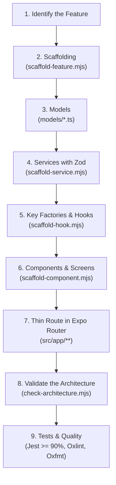

# 📱 React Native Screaming Architecture Standard

## 🎯 Purpose

Standardize the design and modularization of **React Native apps with Expo Router** following **Screaming Architecture** (Feature-Driven / Domain-First), the mobile counterpart of [`nextjs-architecture`](../nextjs-architecture/SKILL.md). It keeps code decoupled through subfolder encapsulation, thin routes in `src/app`, separation of UI, hooks, services, schemas and models, and tests with $\ge 90\%$ coverage.

**Assumed stack:** Expo + Expo Router, TanStack Query, NativeWind (`className`), Zod, Jest + `@testing-library/react-native`, Oxlint + Oxfmt (`sortTailwindcss: true`), and the `@/*` → `src/*` alias.

---

## ⚡ When to Trigger This Skill

- When creating or refactoring business modules in `src/features/<feature-name>/`.
- When creating shared components (`src/components/common/`) or feature-specific ones.
- When wiring screens to Expo Router routes (`src/app/**`).
- When implementing data flows with **TanStack Query** (key factories + hooks + services).
- When defining Zod schemas (`*.schema.ts`) or domain models (`models/*.ts`).
- When checking names, suffixes and the barrel file policy.
- When running static analysis with Oxlint or formatting with Oxfmt.

> **Monorepo:** if the app lives in `apps/mobile`, apply these rules inside `apps/mobile/src/` and also use [`monorepo-architecture`](../monorepo-architecture/SKILL.md). Generate with `--target-dir apps/mobile/src/features --app-dir apps/mobile/src/app`.

---

## 📋 Step-by-Step Workflow



### 1. Domain modeling (`models/`)
Flat TypeScript files in `models/<entity>.ts`, with a `models/index.ts` that re-exports them. No tests.

### 2. Services (`services/`)
One service per subfolder: `<verb>-<noun>/<verb>-<noun>.service.ts` with its test and `index.ts`. They use the typed HTTP client from `src/config/api-client` and validate the response with `schema.parse()`. There are no Server Actions on mobile.

### 3. Schemas (`schemas/`)
Flat `<name>.schema.ts` files with Zod, a `camelCase` constant ending in `Schema`, and a `schemas/index.ts` barrel. No tests.

### 4. Key Factories & Hooks (`hooks/`)
- Key factories in their own subfolders: `hooks/<entity>-keys/<entity>.keys.ts` with the hierarchy `all → lists() → list(filters) → details() → detail(id)`.
- Query and mutation hooks in `hooks/use-<action>/use-<action>.hook.ts`, consuming the matching factory. See the [TanStack Query pattern](references/tanstack-query-pattern.md).

### 5. Components and screens (`components/`, `screens/`)
- Use RN primitives (`View`, `Text`, `Pressable`, `FlashList`, `expo-image`) with NativeWind `className`; no `div`/`span`.
- Each component or screen lives in its subfolder with the implementation, an adjacent test and an `index.ts`.
- Modals: the `--type modal` archetype with customizable labels and `dark:` support. Document props with TSDoc. See the [component patterns](references/nativewind-component-patterns.md).

### 6. Expo Router routes (`src/app/`)
Each `index.tsx`, `[id].tsx` or `_layout.tsx` only imports and re-exports/renders the feature's screen. No logic or tests in `src/app/`; if logic is needed (parameters, access guards), extract it to `src/features/<feature>/utils/`. See [thin routes](references/expo-router-thin-routes.md).

---

## ⚠️ Critical Rules

1. **Reply in the user's language**, even though this skill is written in English.
2. **Barrels only in leaf folders (*Leaf-Folder Barrel Policy*)**: `index.ts` only in folders with direct implementation files (`components/invoice-card/`, `models/`, `schemas/`, `utils/`). Never at the feature root or in groupers such as `components/`, `hooks/`, `screens/`.
3. **Direct imports to the folder that has the `index.ts`**:
   ```typescript
   // ✅ CORRECT
   import { useInvoices } from '@/features/billing/hooks/use-invoices';
   import { invoiceKeys } from '@/features/billing/hooks/invoice-keys';
   import { IInvoice } from '@/features/billing/models';

   // ❌ FORBIDDEN: container folders
   import { useInvoices, IInvoice } from '@/features/billing';
   import { InvoiceCard } from '@/features/billing/components';
   ```
4. **Subfolder encapsulation** in `kebab-case`: implementation, test and `index.ts`.
5. **Thin routes**: `src/app/**` contains no logic and no tests.
6. **Coverage $\ge 90\%$** with adjacent tests (`.test.ts(x)`). Excluded: `models/`, `schemas/`, `hooks/*-keys/`, `src/app/`, `index.ts` barrels and pure constants (`src/config/env.ts`, `src/config/constants.ts`). Modules with logic or I/O in `src/config/` (such as `api-client.ts`) do need unit tests.
7. **No web APIs, and secure storage**: no `div`, `window` or `localStorage`. Use RN primitives; store session tokens only in `expo-secure-store`, never in `AsyncStorage`.
8. **Boundaries between features**: a feature must not import another feature's internal `screens/` or `components/`. Shared components or utilities must be promoted to `src/components/common/`, `src/lib/` or `src/stores/`.

---

## 📚 References

- [Screaming Architecture Guide](references/screaming-architecture-guide.md): directory structure, layers and naming conventions.
- [Thin Routes with Expo Router](references/expo-router-thin-routes.md): how to wire screens to `src/app`.
- [Navigation and Authentication](references/navigation-and-auth.md): `(auth)`/`(app)` groups, `Stack.Protected`, typed routes and secure tokens.
- [TanStack Query Pattern](references/tanstack-query-pattern.md): services, key factories, queries and mutations.
- [State, Forms and Offline](references/state-forms-and-offline.md): Zustand, react-hook-form + Zod, AppState and NetInfo.
- [NativeWind Component Patterns](references/nativewind-component-patterns.md): primitives, modals and testing.
- [Platform, Performance and Accessibility](references/platform-performance-a11y.md): `.ios`/`.android`, FlashList, expo-image and a11y.
- [Testing and Tooling (Jest + OXC)](references/testing-and-tooling.md): jest-expo, Oxlint with architectural rules, and Oxfmt.

---

## 🛠️ Scripts

> **Paths:** `<skill-dir>` is the directory that holds this `SKILL.md` (e.g. `.claude/skills/<name>/` or `.agents/skills/<name>/`). Run the scripts from the user's project root, not from `<skill-dir>`.

> **Safety:** the scripts abort without writing anything if any of the files they generate already exists. Run them with `--dry-run` first to see what will be created. Use `--force` (which overwrites those files) only with the user's explicit confirmation.

### 1. Generate a full feature
```bash
node <skill-dir>/scripts/scaffold-feature.mjs <feature-name> [--target-dir <path>] [--app-dir <path>] [--route-path <path>] [--with-starter] [--with-route] [--with-layout] [--minimal] [--dry-run] [--force]
```
*Example:* `node <skill-dir>/scripts/scaffold-feature.mjs billing --with-starter --with-route --route-path "(tabs)/billing" --with-layout`

### 2. Generate an encapsulated component
```bash
node <skill-dir>/scripts/scaffold-component.mjs <component-name> [--target-dir <path>] [--type default|modal|section] [--dry-run] [--force]
```
*Example:* `node <skill-dir>/scripts/scaffold-component.mjs create-invoice-modal --target-dir src/features/billing/components --type modal`

### 3. Generate a TanStack Query hook
```bash
node <skill-dir>/scripts/scaffold-hook.mjs <hook-name> --feature <feature-name> [--kind query|mutation] [--entity <name>] [--dry-run] [--force]
```
*Example:* `node <skill-dir>/scripts/scaffold-hook.mjs use-invoices --feature billing --kind query --entity invoice`

### 4. Generate a data service
```bash
node <skill-dir>/scripts/scaffold-service.mjs <verb-noun> --feature <feature-name> [--dry-run] [--force]
```
*Example:* `node <skill-dir>/scripts/scaffold-service.mjs get-invoices --feature billing`

### 5. Set up standard tooling (Jest + OXC)
```bash
node <skill-dir>/scripts/setup-tooling.mjs [--only lint|format|test] [--dry-run] [--force]
```
*Example:* `node <skill-dir>/scripts/setup-tooling.mjs`

### 6. Validate the Screaming Architecture rules
```bash
node <skill-dir>/scripts/check-architecture.mjs [--src-dir <dir>] [--include-imports] [--json]
```
*Example:* `node <skill-dir>/scripts/check-architecture.mjs --include-imports`
