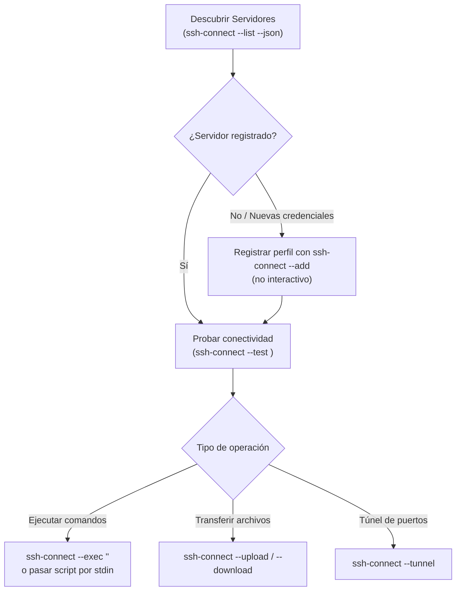

# 🖥️ Conexión y Operación en Servidores Remotos (`ssh-connect`)

## 🎯 Propósito

Permitir al agente conectarse, inspeccionar y ejecutar tareas en servidores remotos de forma confiable, no interactiva y segura mediante `ssh-connect`. Maneja automáticamente la autenticación por archivo `.pem` (corrigiendo permisos `chmod 600`), contraseñas almacenadas en el Keychain de macOS o archivos protegidos, y multiplexación de sesiones OpenSSH (`ControlMaster`) para ejecuciones consecutivas instantáneas.

## ⚡ Cuándo Activar esta Skill

- Cuando el usuario solicite conectarse, ejecutar comandos o verificar el estado de un servidor remoto por SSH.
- Cuando se proporcione una IP o dominio con credenciales (usuario, contraseña o archivo `.pem`) para operar un host.
- Cuando se requiera transferir archivos hacia o desde un servidor remoto (`--upload`, `--download`).
- Cuando se deba diagnosticar un servicio remoto (Docker, systemd, logs de Nginx, uso de disco o memoria).

## 📋 Flujo de Trabajo Paso a Paso



### Paso 1: Descubrimiento de Servidores Configurados

Consulta los servidores ya registrados sin exponer contraseñas ni rutas sensibles:

```bash
ssh-connect --list --json
```

Si el servidor ya existe, anota su `alias` para las operaciones siguientes.

### Paso 2: Registrar un Nuevo Servidor (si es necesario)

Si el usuario facilita credenciales nuevas durante la conversación, regístralo sin interacción:

```bash
# Servidor con archivo .pem / llave privada:
ssh-connect --add --alias prod-api --host 54.123.45.67 --user ubuntu --port 22 --type pem --key ~/.ssh/aws.pem

# Servidor con contraseña (pasada por stdin para evitar historial):
printf "%s\n" "MiPasswordSeguro" | ssh-connect --add --alias legacy-vps --host 192.168.1.50 --user root --port 22 --type password --pass-stdin

# Servidor con agente SSH o llave predeterminada:
ssh-connect --add --alias staging --host staging.example.com --user deploy --type agent
```

### Paso 3: Verificar Conectividad

Antes de ejecutar tareas complejas, comprueba que el host responda y la autenticación sea válida:

```bash
ssh-connect --test <alias>
```

Si el servidor tiene llave `.pem`, `ssh-connect` revisará y ajustará automáticamente los permisos a `600` si estaban demasiado permisivos.

### Paso 4: Ejecución No Interactiva de Comandos

**NUNCA** invoques `ssh-connect <alias>` sin comando, ya que abrirá una shell interactiva que congelará el proceso del agente al esperar un TTY.

Usa siempre el modo `--exec`:

```bash
# Comando simple:
ssh-connect --exec <alias> "uptime && free -h"

# Scripts multilínea complejos mediante stdin:
ssh-connect --exec <alias> << 'EOF'
set -euo pipefail
echo "=== Diagnóstico del sistema ==="
df -h /
docker ps --format "table {{.Names}}\t{{.Status}}\t{{.Ports}}"
systemctl is-active nginx || sudo systemctl restart nginx
EOF
```

Gracias a OpenSSH `ControlMaster`, la primera llamada abre el socket de conexión y las llamadas posteriores durante los siguientes 10 minutos se ejecutan de inmediato sin renegociar la sesión SSH.

### Paso 5: Transferencia de Archivos

Para mover artefactos de despliegue, archivos de configuración o descargar logs remotos:

```bash
# Subir archivo o carpeta local al servidor:
ssh-connect --upload <alias> ./dist/ /var/www/app/

# Descargar logs o respaldos remotos a la máquina local:
ssh-connect --download <alias> /var/log/nginx/error.log ./logs/
```

### Paso 6: Cerrar Sesión Persistente (Opcional)

Al concluir las tareas en el servidor:

```bash
ssh-connect --disconnect <alias>
```

## 🛠️ Scripts y Herramientas Auxiliares

- `ssh-connect`: Comando ejecutable central instalado en el sistema (gestor de perfiles, conector SSH, túneles y SCP).
- [`references/commands_cheatsheet.md`](references/commands_cheatsheet.md): Referencia rápida de recetas de diagnóstico remoto (Docker, systemd, bases de datos y red).

## ⚠️ Reglas Críticas

1. **No Interactividad Absoluta**:
   - Nunca ejecutes `ssh-connect <alias>` sin `--exec` o sin comandos remotos, ya que abrirá una pseudo-terminal interactiva que bloqueará al agente.
   - Pasa siempre argumentos no interactivos a `ssh-connect --add`.
2. **Seguridad y Confidencialidad de Credenciales**:
   - Nunca imprimas contraseñas en texto claro en la consola ni en el chat. Al registrar servidores por contraseña, usa `--pass-stdin` o guárdala en el Keychain del sistema.
   - Si se requiere una llave privada, solicita al usuario la ruta del archivo `.pem` en su disco local.
3. **Acciones Remotas Críticas Requieren Confirmación**:
   - Comandos destructivos como `rm -rf`, reinicio de servidores (`reboot`), formateo de volúmenes o modificaciones irreversibles en bases de datos deben mostrarse primero al usuario para su aprobación explícita.
4. **Validación Previa con `--test`**:
   - Verifica la conexión con `ssh-connect --test <alias>` antes de lanzar scripts largos o procesos de despliegue.

## 📚 Referencias Adicionales

* [CheatSheet de Comandos y Diagnóstico Remoto](references/commands_cheatsheet.md)
