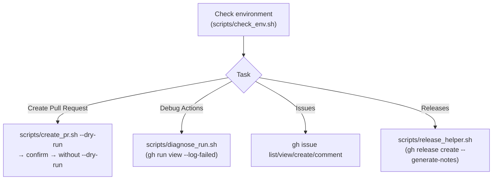

# 🐙 GitHub CLI (`gh`) Workflow & Automation

## 🎯 Purpose
Guides the assistant through managing **GitHub** repositories with the `gh` CLI and helper scripts. It standardizes **Pull Request** creation (Conventional Commits, an emoji per type, a scope only when there is an issue, labels that already exist in the repo), diagnosing failed **GitHub Actions**, working with issues, and publishing releases with notes generated by GitHub.

## ⚡ When to Trigger
- When working on repositories hosted on GitHub (`github.com` or GitHub Enterprise).
- When creating, reviewing, approving or merging Pull Requests (`gh pr` or `scripts/create_pr.sh`).
- When diagnosing failed GitHub Actions workflows or checks (`gh run`, `gh pr checks` or `scripts/diagnose_run.sh`).
- When creating, listing or commenting on issues, or publishing releases and tags.
- Not for GitLab repositories.

## 📋 Workflow



1. **Step 1: Check state and authentication**:
   ```bash
   bash <skill-dir>/scripts/check_env.sh
   ```
   If authentication fails, ask the user to run `gh auth login`; never ask for or write tokens.

2. **Step 2: Create a standardized Pull Request**:
   - Always preview first and show the user the title, labels and base branch:
     ```bash
     # Issue detected from the branch (feat/42-login-form) or given explicitly:
     bash <skill-dir>/scripts/create_pr.sh --issue 42 --domain auth --dry-run

     # No issue (title without scope: <type>: <emoji> <desc>):
     bash <skill-dir>/scripts/create_pr.sh --dry-run
     ```
   - After confirmation, run the same command without `--dry-run`. Add `--push` only if the branch is not published and the user approves it; add `--draft` if the work is not ready.
   - Manual alternative: `gh pr create --title "<title>" --body "<body>" --base main`.

3. **Step 3: Review and merge PRs**:
   ```bash
   gh pr view <n> --comments        # context and conversation
   gh pr diff <n>                   # changes
   gh pr checks <n>                 # CI status
   gh pr review <n> --approve       # or --request-changes --body "..."
   gh pr merge <n> --squash --delete-branch   # only with the user's explicit approval
   ```

4. **Step 4: Diagnose GitHub Actions**:
   ```bash
   # Latest failed run on the current branch, logs of failed steps only:
   bash <skill-dir>/scripts/diagnose_run.sh

   # Checks of a PR and logs of one job:
   bash <skill-dir>/scripts/diagnose_run.sh --pr 57 --job lint --lines 50
   ```
   Read the log, find the cause and fix the code. Retry (`gh run rerun <id> --failed`) only if the failure is transient (network, runner down).

5. **Step 5: Issues and releases**:
   ```bash
   gh issue list --assignee @me --state open
   gh issue view 42 --comments
   bash <skill-dir>/scripts/release_helper.sh draft-notes
   bash <skill-dir>/scripts/release_helper.sh create v1.4.0 --dry-run
   ```

## 🛠️ Helper Scripts

> **Paths:** `<skill-dir>` is the directory that holds this `SKILL.md` (e.g. `.claude/skills/<name>/` or `.agents/skills/<name>/`). Run the scripts from the root of the user's project, not from `<skill-dir>`.

- [`scripts/check_env.sh`](scripts/check_env.sh): Checks `git`, `gh`, the active session and the GitHub repository behind `origin`.
- [`scripts/create_pr.sh`](scripts/create_pr.sh): Creates the PR with:
  - A title with an issue: `<type>(#<issue-id>): <emoji> <description>`; without one: `<type>: <emoji> <description>`.
  - A type label from GitHub's default labels (`enhancement`, `bug`, `documentation`) and an optional `domain: <name>`.
  - Allowed domains: if `.gh-domains` exists at the repo root (one per line), `--domain` must be in that list.
  - Up-front checks that every label exists, that the branch has no open PR yet and that the branch has an upstream.
  - A body with `Closes #<id>`, a commit summary and the `.github/pull_request_template.md` template if it exists.
- [`scripts/diagnose_run.sh`](scripts/diagnose_run.sh): Latest failed run of the branch or PR and the logs of its failed steps, filterable by job.
- [`scripts/release_helper.sh`](scripts/release_helper.sh): `list`, `view`, `draft-notes` and `create <tag>` with SemVer validation and notes generated by GitHub.

## ⚠️ Critical Rules

1. **Reply in the user's language**, even though this skill is written in English. PR titles and bodies follow the repository's existing language.
2. **PR title and scope rule**:
   - With an issue: `<type>(#<issue-id>): <emoji> <description>` (e.g. `feat(#42): ✨ login form`).
   - Without an issue: `<type>: <emoji> <description>` (e.g. `chore: 🔧 upgrade dependencies`).
   - **NEVER** use folders, packages or apps as the scope (`feat(web): ...` is FORBIDDEN).
3. **Existing labels only, never invented**:
   - Use only labels that already exist in the repository (`gh label list`). Do not run `gh label create` without the user's explicit permission.
   - Valid domains are the ones in `.gh-domains`; never invent one.
4. **Actions with external effects need confirmation**:
   - Creating or merging PRs, approving, closing issues, publishing releases, re-running workflows or pushing: first show what will happen (`--dry-run`) and wait for confirmation.
   - **FORBIDDEN**: `git push --force` to shared branches, `gh pr merge --admin` to bypass protections, and `gh repo delete`.
5. **Never interactive**: Always pass `--title`/`--body` (or `--fill`) and explicit flags; never leave `gh` waiting on a prompt.
6. **Credentials**: Never print, ask for or store tokens (`GH_TOKEN`, `gh auth token`). The user authenticates with `gh auth login`.
7. **Structured output**: To read data, use `--json <fields> --jq <filter>` instead of parsing formatted text.

## 📚 References

* [GitHub standards: PR titles, emojis, labels and body](references/github_standards.md)
* [gh command cheat sheet](references/commands_cheatsheet.md)
* [GitHub Actions and troubleshooting](references/actions_and_troubleshooting.md)
* [Workflow examples](examples/workflows.md)
