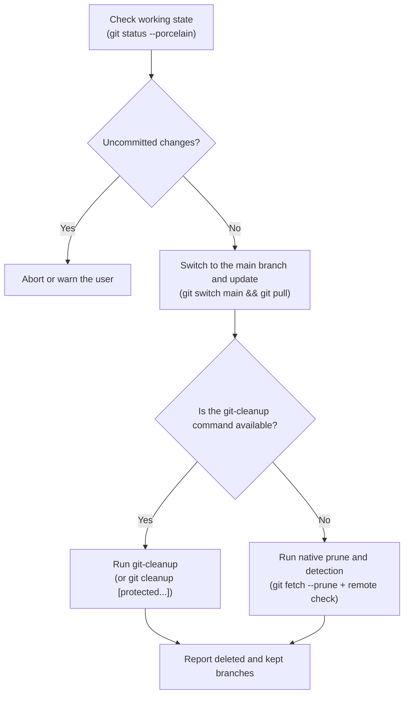

# 🧹 Local Git Branch Cleanup and Hygiene (`git-cleanup`)

## 🎯 Purpose

Safely deletes local Git branches that were already merged and deleted on `origin`, especially after a **Squash & Merge** on GitHub/GitLab, where `git branch --merged` fails because the commits no longer match. It always protects the main branches (`main`, `master`, `develop`) and any branch configured as protected.

## ⚡ When to Trigger

- Right after a Pull Request or Merge Request is merged and `main` is updated.
- When the user asks to clean up or prune stale local branches (*"clean up the local branches"*, *"delete merged branches"*, *"run git cleanup"*).
- When starting a new task, to begin from a clean working tree without piled-up local branches.

## 📋 Workflow



### Step 1: Make Sure the Main Branch Is Up to Date

Before cleaning any branch, switch to the main branch (usually `main` or `master`) and pull the remote changes:

```bash
git switch main
git pull
```

If you are on a branch that should be deleted, Git will not delete it while it is checked out.

### Step 2: Run the Cleanup

#### Case A: The `git-cleanup` command is installed
Run the tool directly:

```bash
git-cleanup
```

You can pass extra protected branches as arguments or read them from the config:
```bash
git-cleanup develop staging
```

#### Case B: Standalone native mode (fallback when `git-cleanup` is not installed)
If `command -v git-cleanup` fails, run this native procedure, which reproduces the same protection and squash-merge detection logic:

```bash
# 1. Prune remote refs deleted on origin
git fetch --prune

# 2. Define the protected branches
PROTECTED=("main" "master" "develop" "staging")

# 3. Read extra protections from git config, if any
while IFS= read -r configured; do
  [[ -n "$configured" ]] && PROTECTED+=("$configured")
done < <(git config --get-all cleanup.protected 2>/dev/null || true)

# 4. Inspect local branches and delete the ones missing on origin
for branch in $(git for-each-ref --format='%(refname:short)' refs/heads/); do
  # Check whether it is protected
  skip=false
  for excl in "${PROTECTED[@]}"; do
    if [[ "$branch" == "$excl" ]]; then
      skip=true
      break
    fi
  done
  if $skip; then
    continue
  fi

  # If the branch still exists on origin, keep it
  if git show-ref --verify --quiet "refs/remotes/origin/$branch"; then
    continue
  fi

  # Not on origin and not protected: delete it
  echo "Deleting stale local branch: $branch"
  git branch -D "$branch"
done
```

### Step 3: Configure Permanently Protected Branches (optional)

If the project has long-lived branches that must never be deleted (e.g. `release/*`, `develop`):

```bash
# For the current repository:
git config --add cleanup.protected develop

# For all of the user's repositories:
git config --global --add cleanup.protected develop
```

## 🛠️ Helper Scripts

- `git-cleanup`: Standalone CLI available in the user's script collection.
- [`references/branch_hygiene.md`](references/branch_hygiene.md): Detailed guide to the squash-merge problem, the difference between `git branch -d` and `git branch -D`, and Git hygiene good practices.

## ⚠️ Critical Rules

1. **Reply in the user's language**, even though this skill is written in English.
2. **Never delete the main branches**:
   - `main`, `master` and `develop` must **NEVER** be deleted.
3. **Always switch to `main` before pruning**:
   - Never run the cleanup while on a temporary feature branch.
4. **Prune the remote first (`git fetch --prune`)**:
   - Always sync the state of `origin` before evaluating local branches; otherwise branches already deleted on GitHub look alive in the local cache.
5. **Check for unpublished work**:
   - If a branch never tracked a remote on `origin` and holds important local commits that were never pushed, warn the user before force-deleting it with `-D`.

## 📚 References

* [Branch Hygiene and Squash Merge Guide](references/branch_hygiene.md)
