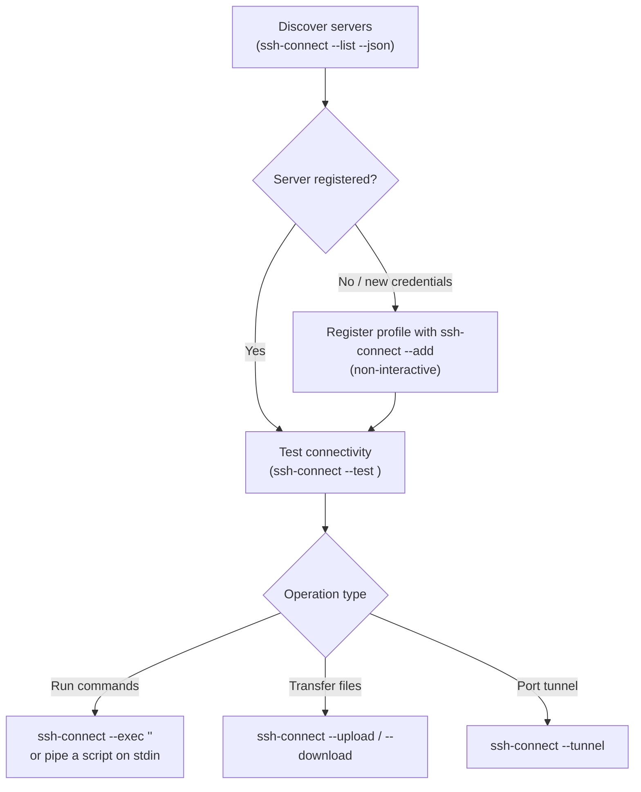

# 🖥️ Connecting to and Operating Remote Servers (`ssh-connect`)

## 🎯 Purpose

Lets the agent connect to, inspect and run tasks on remote servers reliably, non-interactively and safely through `ssh-connect`. It handles `.pem` key authentication automatically (fixing permissions with `chmod 600`), passwords stored in the macOS Keychain or protected files, and OpenSSH session multiplexing (`ControlMaster`) so consecutive runs are instant.

## ⚡ When to Trigger

- When the user asks to connect to a remote server over SSH, run commands on it or check its status.
- When the user gives an IP or domain with credentials (user, password or `.pem` file) to work on a host.
- When files need to move to or from a remote server (`--upload`, `--download`).
- When a remote service needs diagnosing (Docker, systemd, Nginx logs, disk or memory usage).

## 📋 Workflow



### Step 1: Discover Configured Servers

List the registered servers without exposing passwords or sensitive paths:

```bash
ssh-connect --list --json
```

If the server already exists, note its `alias` for the next steps.

### Step 2: Register a New Server (if needed)

If the user gives new credentials in the conversation, register the server non-interactively:

```bash
# Server with a .pem file / private key:
ssh-connect --add --alias prod-api --host 54.123.45.67 --user ubuntu --port 22 --type pem --key ~/.ssh/aws.pem

# Server with a password (passed on stdin to keep it out of shell history):
printf "%s\n" "MySecurePassword" | ssh-connect --add --alias legacy-vps --host 192.168.1.50 --user root --port 22 --type password --pass-stdin

# Server with the SSH agent or the default key:
ssh-connect --add --alias staging --host staging.example.com --user deploy --type agent
```

### Step 3: Check Connectivity

Before running complex tasks, check that the host responds and authentication works:

```bash
ssh-connect --test <alias>
```

If the server uses a `.pem` key, `ssh-connect` checks its permissions and sets them to `600` if they were too open.

### Step 4: Run Commands Non-Interactively

**NEVER** run `ssh-connect <alias>` without a command: it opens an interactive shell that freezes the agent while it waits for a TTY.

Always use `--exec`:

```bash
# Simple command:
ssh-connect --exec <alias> "uptime && free -h"

# Complex multi-line scripts through stdin:
ssh-connect --exec <alias> << 'EOF'
set -euo pipefail
echo "=== System diagnostic ==="
df -h /
docker ps --format "table {{.Names}}\t{{.Status}}\t{{.Ports}}"
systemctl is-active nginx || sudo systemctl restart nginx
EOF
```

With OpenSSH `ControlMaster`, the first call opens the connection socket and later calls in the next 10 minutes run immediately, without renegotiating the SSH session.

### Step 5: Transfer Files

To move deployment artifacts or config files, or to download remote logs:

```bash
# Upload a local file or folder to the server:
ssh-connect --upload <alias> ./dist/ /var/www/app/

# Download remote logs or backups to the local machine:
ssh-connect --download <alias> /var/log/nginx/error.log ./logs/
```

### Step 6: Close the Persistent Session (optional)

When you are done on the server:

```bash
ssh-connect --disconnect <alias>
```

## 🛠️ Helper Scripts

- `ssh-connect`: The main executable installed on the system (profile manager, SSH connector, tunnels and SCP).
- [`references/commands_cheatsheet.md`](references/commands_cheatsheet.md): Quick reference of remote diagnostic recipes (Docker, systemd, databases and network).

## ⚠️ Critical Rules

1. **Reply in the user's language**, even though this skill is written in English.
2. **Never interactive**:
   - Never run `ssh-connect <alias>` without `--exec` or a remote command: it opens an interactive pseudo-terminal that blocks the agent.
   - Always pass non-interactive arguments to `ssh-connect --add`.
3. **Keep credentials secret**:
   - Never print passwords in plain text in the console or the chat. When registering a password server, use `--pass-stdin` or store it in the system Keychain.
   - If a private key is needed, ask the user for the path to the `.pem` file on their local disk.
4. **Critical remote actions need confirmation**:
   - Show destructive commands such as `rm -rf`, server reboots (`reboot`), volume formatting or irreversible database changes to the user first and wait for their explicit approval.
5. **Check first with `--test`**:
   - Verify the connection with `ssh-connect --test <alias>` before running long scripts or deployments.

## 📚 References

* [Remote Commands and Diagnostics Cheat Sheet](references/commands_cheatsheet.md)
